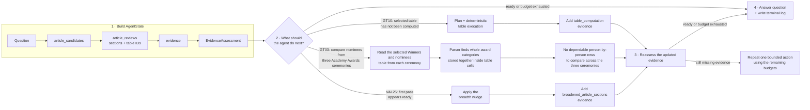

# Checkpoint 5.1: from retrieval to evidence control

This checkpoint builds the first *agentic* retriever in the project. Instead of a
fixed retrieve-then-answer pass, the graph carries an `AgentState`, inspects its
own evidence, and chooses among three different kinds of follow-up work:

- compute over a selected table;
- broaden the selected articles with more of their own sections; or
- expand retrieval to related articles.

It continues the experiment narrative from
[Checkpoint 4.1](../Capstone%20Checkpoint%204.1/README%204.1.md). General LangChain
and LangGraph syntax lives in the repository-level
[LangChain guide](../../LANGCHAIN_GUIDE.md).

This document is a **progression log**. It records what failed, what evidence
exposed the failure, and why the next capability was added. The goal is to make
the evolution reconstructable, not merely describe the final graph.

---

## Final result at a glance

The most important result is not one score. It is the separation of retrieval
quality from evidence quality:

- On both the final GT and validation agent runs, designated-article recall held
  at **1.000**.
- On the table-heavy 19-question GT set, forcing selected tables through
  deterministic lookup/computation raised mean quality from **0.579** for the
  TOC-only agent to **0.789**, with strict PASS rising from **40.8%** to **75.0%**.
- The 25-question held-out validation set exposed a different weakness. The
  section-focused agent retained **1.000 recall** but scored only **0.845** because
  several long-form answers needed more article context than the selected sections
  supplied.
- Adding one bounded same-article breadth round raised validation quality to
  **0.880** while recall stayed **1.000**. That recovered most, but not all, of the
  gap to the Checkpoint 4.1 graph baseline (**0.885** quality at **0.973** recall).
- The breadth version still used about **48.3K** context characters per question,
  roughly one fifth of the 4.1 graph baseline's **237.7K**.

So the final conclusion is deliberately mixed: deterministic table work solved a
real class of failures, but replacing whole-article breadth with selected sections
introduced a new class of synthesis failures. Perfect article recall tells us the
right sources were found; it does not prove the answer model received the right
parts of those sources.

```mermaid
flowchart LR
    A[4.1: broad article context<br/>strong answers, expensive context]
    B[5.1: section-aware retrieval<br/>less noise, smaller context]
    C[TOC review<br/>keep the right articles and sections]
    D[Normalized tables<br/>repair row alignment and semantics]
    E[Forced lookup + compute<br/>deterministic table evidence]
    F[Held-out validation<br/>prose synthesis regresses]
    G[Bounded article breadth<br/>recover more same-article context]

    A -->|context was too large| B
    B -->|correct articles were rejected| C
    C -->|table rows were misaligned| D
    D -->|assessor sometimes skipped compute| E
    E -->|GT improved; validation exposed starvation| F
    F -->|premature ready verdicts| G
```




## 1. Starting point (from Checkpoint 4.1)

4.1 established two things that frame this checkpoint:

- **Retrieval was already strong.** The best 4.1 configuration — the graph
retriever (`vector_graph`) — reached mean designated-article recall **0.939**,
but it did so by brute breadth: ~**7.4 articles** and ~**260,000 context
characters** per question. See
[ragas_GT_evaluation_graph_retriever.pdf](../Capstone%20Checkpoint%204.1/ragas_GT_evaluation_graph_retriever.pdf).
- **Answer quality was flat.** More retrieval did not move it. The remaining
failures clustered on tasks that require reading, filtering, or aggregating
**tables**, and the 260K-character context was the "full articles don't fit"
problem this checkpoint set out to replace with *selected sections*.

**Hypothesis for 5.1:** a bounded evidence graph that (a) sends only relevant
sections and (b) can escalate retrieval on demand will match 4.1's recall at a
fraction of the context, and will isolate whether the remaining failures are
retrieval or table synthesis. The bar is explicit: **do better than 4.1, or the
added machinery isn't worth it.**

## 2. Final graph: one state, three escalation paths

The final graph keeps the initial retrieval and evidence-selection stages common,
then uses the assessment result plus explicit safeguards to choose the next path.
Table and retrieval budgets are independent, so a bad table plan cannot create an
unbounded loop or consume the entire retrieval sequence.

```text
START
  -> entity-decomposed article retrieval
  -> review candidate TOCs            (keep/reject; select sections + table IDs)
  -> load selected sections
  -> load selected normalized tables  (additive; prose is preserved)
  -> assess evidence
       |-- selected table not yet computed
       |      -> auto request -> plan lookup/filter/aggregate -> execute -> assess
       |
       |-- non-table, first-pass ready
       |      -> readiness nudge -> broaden selected articles -> assess
       |
       |-- still missing evidence
       |      -> graph-seeded related sections -> assess
       |
       +-- ready/budgets exhausted --> write terminal-state log --> END
                                                                    |
                                                                    v
                                                       harness answer model + RAGAS
```

Evidence remains bounded: selected sections are loaded first, table evidence is
computed only from selected immutable artifacts, and breadth adds the top sections
of already-selected articles rather than reinstating full articles. Whole articles
and fixed leading-character slices are never sent to the answer model.

Per-run evidence is written to `logs/YYYY_MM_DD_HH_MM_SS/NNN__<slug>.evidence.json`
(one file per question, full terminal state). RAGAS scores the run and writes a
result row per question; aggregate PDFs are produced by
[`utils/analyze_ragas_experiments.py`](../utils/analyze_ragas_experiments.py).

## 3. Progression and decisions


### Step 0 — baseline

4.1 graph retriever, full 19 GT questions: recall **0.939**, ~7.4 articles/q,
~260K chars/q. This is the number to beat.

### Step 1 — honest baseline and failure localization

The first full 19-question agent run produced ~**0.49 PASS** at ~**0.89** recall.
Every stable failure was a **row-wise table operation** (GT03
intersection, GT07 aggregation, GT08 filter, GT10/GT11 program filter); prose and
relationship questions pass stably. Because recall was ~0.89 with most failures at
recall 1.0, the right article was already being retrieved.

Reading the evidence logs showed the drop was **not context volume** (5.1 sends
~15–18K chars, far below 4.1's 260K). It was two retrieval-quality problems plus a
reasoning floor:

- **Wrong section inside the right article.** The initial stage kept only the
single best-matching chunk per article; for a table article that is the prose
*preamble*, not the data rows. On GT07 the Best Actor "Winners and nominees"
chunk was the table key ("‡ indicates the winner…") with **zero winner rows**.
- **Graph-expansion contamination.** Graph-seeded retrieval added the top sections
of *every* neighbor unconditionally; expanding an award seed pulled sibling
awards (Best Picture/Director/Supporting, Golden Globe) whose overlapping names
mislead an aggregation over Best Actor.
- **Table reasoning is the floor.** GT11 retrieved the correct Sport/Years section
with the answer data present, cleanly, and still failed. Perfect retrieval,
wrong answer — the Phase 2 ceiling.

### Step 2 — make the graph observable through `AgentState`

The next improvement was not another retriever. It was observability. Each question
now writes its terminal `AgentState` to a separate evidence log containing:

- candidate, selected, and rejected articles;
- article reviews and exact section/table selections;
- accumulated `EvidenceItem` objects and their retrieval stages;
- every `EvidenceAssessment`, including its requests and explanation;
- retrieval and table attempt counts; and
- computed table plans, results, warnings, and source-cell provenance.

That changed the development loop from “the score went down” to “this exact node
discarded or distorted the needed evidence.” Later decisions—the TOC reviewer,
table gateway, layout-table diagnosis, and breadth nudge—were all triggered by
reading these logs rather than guessing from aggregate scores.

```text
aggregate score changes
        |
        v
open one question's AgentState
        |
        +-- right article absent?      -> retrieval problem
        +-- candidate found/rejected?  -> review problem
        +-- right table, bad rows?     -> representation problem
        +-- plan/result wrong?         -> planner/executor problem
        +-- all evidence present?      -> synthesis/readiness problem
```


### Step 3 — retrieval tune-up

Three changes, each targeting one problem above:

1. **Initial article count is a real parameter.** It had been hard-coded to 3, so
   an earlier `INITIAL_ARTICLE_TOP_K` change never took effect. Now seeds 4 to
   cover four-article questions (GT14: Chazelle + Emma Stone + La La Land + 89th).
2. **Selected-article deepening.** `retrieve_selected_article_sections` is wired
   between collection and assessment, so each selected article contributes several
   focused sections initially — the row-bearing chunk arrives before assessment.
   These are vector searches; no added LLM calls.
3. **Graph contamination gating.** Neighbor sections are pooled across all
   neighbors, ranked by match distance, and capped (`max_graph_sections`), so
   adjacent-but-wrong neighbors are outcompeted instead of each contributing
   chunks.

**Three-run comparison** (4 runs each, means; see
[ragas_agentic_retriever_loop_v2.pdf](ragas_agentic_retriever_loop_v2.pdf)):


| configuration      | article recall | PASS      | context chars/q | articles/q |
| ------------------ | -------------- | --------- | --------------- | ---------- |
| 4.1 graph baseline | 0.939          | —         | ~260,000        | 7.4        |
| 5.1 pre-tune       | 0.886          | 0.487     | ~18,000         | 3.5        |
| **5.1 tuned**      | **0.963**      | **0.592** | ~19,000         | 3.2        |


Recall rose **0.886 → 0.963**, now **above the 4.1 baseline (0.939)** while
sending ~14× less context (one run reached recall 1.000). GT14 went to 4/4 at
recall 1.0 (k=4 applied), and GT07's winner-rows chunk now arrives at the deepen
stage with no sibling-award contamination. The "do better than 4.1" bar is met on
retrieval.

The clearest evidence that the ceiling is now synthesis: the tuned run
`infallible_hopper` retrieved at recall **0.974** but passed only **0.42** — near
perfect retrieval, answers still limited.

### Step 4 — GT16 and the entity-aware initial retriever

One residual retrieval gap remained after the tune-up: **GT16** (recall ~0.75).
Its designated articles are `Bill_Clinton` and `Barack_Obama` — both **named in the
question** — and the answer (Hillary Clinton; spouse / 2008 primary opponent /
Secretary of State) is synthesized from those two articles. `Barack_Obama` was
inconsistently retrieved. A direct probe of the section index shows why:


| query                   | top unique articles                                             |
| ----------------------- | --------------------------------------------------------------- |
| full GT16 question      | `Bill_Clinton` (0.762), `George_W._Bush` (0.917) — Obama absent |
| targeted "Barack Obama" | `Barack_Obama` at **rank 1** (0.897)                            |


A single blunt question-level search is dominated by one entity's chunks and
buries the other named entity, even though a targeted query retrieves it
instantly. Graph expansion is the wrong tool (it finds *unnamed, related*
articles; both endpoints here are named). The capability GT16 needs is **query
decomposition into the named entities**, which is a job for the
`MultiStepRetriever`.

**First attempt — reuse the 4.1 sub-topic decomposer — was a wash.** Its prompt is
tuned to emit terminology-rich sub-topic queries for the *answer* step, so for
GT16 it produced entity-*diluted* sentences like
`"2008 Obama presidential election Bill Clinton campaign supporter advisor"` that
retrieve Clinton, not Obama. Across two runs GT16 stayed at recall 0.5–1.0 and
kept failing; overall recall did not beat the vector-initial tune-up (0.951 vs
0.963). Retrieving one entity per sub-query requires *entity* queries, not
sub-topic sentences.

**Decision — an entity-aware decomposer.** `MultiStepRetriever.decompose_entities`
emits one clean canonical entity name per named or directly-implied entity, which
the probe shows retrieves the exact designated article at rank 1. Validated on the
real model:


| question | `decompose_entities` output                                              |
| -------- | ------------------------------------------------------------------------ |
| GT16     | `["Bill Clinton", "Barack Obama", "Hillary Clinton"]`                    |
| GT14     | `["Damien Chazelle", "Emma Stone", "La La Land", "89th Academy Awards"]` |
| GT07     | `["Academy Award for Best Actor"]`                                       |
| GT11     | `["Summer Olympic Games"]`                                               |


Each name retrieves its designated article at rank 1 (`Bill Clinton` → 0.66,
`Barack Obama` → 0.90, `Emma Stone` → 0.68, `Academy Award for Best Actor` →
0.66). The full question is always included as one query too, so its candidates
remain in the merged pool alongside the entity-specific results. At this phase,
**entity multi-step** becomes the settled initial strategy while graph expansion
remains the repeated route. Validation later inserts article breadth before that
graph fallback. See §4.

This closed the *retrieval* side of GT16 (both named articles reliably surfaced).
It did **not** make GT16 pass: even at recall 1.0 the answer failed to assemble
the three edges, which is relationship **synthesis**, not retrieval. At this point
the repeated route was still graph-seeded; the later validation work adds
`article_broaden` ahead of it.

### Step 5 — the real cap was the review node: judge by TOC, select sections

With the entity retriever finding the right articles, run 1's recall was still only
0.864 — *below* the vector-initial tune-up. The logs showed why: the designated
articles were now in the **candidates**, but the article-review node **rejected**
them. It judged each article by **one snippet** (the entity query's best chunk),
which for these articles was `See also` or the lead infobox — not the answer — so
it discarded the whole article. GT03 rejected all seven candidates → empty
selection → graph expansion (which seeds from the selection) had nothing to expand
→ **recall 0.0**. The bottleneck had moved from *finding* to *keeping*.

The fix is one **fused call over each article's table of contents**
([`review_and_select_from_toc`](../wiki_agents/retrieval_nodes.py)):

- **Judge the article** by its title + section list, not a snippet — is this the
right source?
- **Select the sections** to read, by name, from the TOC.
- **Flag tables** needed (`needs_table_reader`, `relevant_table_names`) — the
Phase 2 signal ("yes, there is a table; we will need the table tool").

`load_selected_sections` then loads those named sections into evidence, and a
safety net keeps the best-ranked candidate if the model ever rejects everything
(so selection is never empty). Validated live on GT03 (real TOC + model): it now
**keeps all three ceremonies**, selects `Winners and nominees` for each, rejects
the distractors (Best Picture, Bill Clinton), and sets `needs_table_reader=True`.
The recall-0.0 collapse is gone.

This is still a **retrieval/selection** fix: it makes the right data present and
flags the table need. Reading and synthesizing the table is Phase 2.

### Step 6 — Phase 2: aligned tables (representation) then computation

Phase 2 began by asking the cheaper question first: does *reading* the table (as
structured rows) fix the synthesis failures, or is *computation* required? The
answer came in two parts.

**Two JSON tables exist, and it mattered.** The corpus has two machine-readable
renderings of every table: the 4.1 **sidecar** (`corpus.py`, rows as lists, no
rowspan expansion) and the 5.1 **NormalizedTable** artifacts (`wiki_table_parser`

- `wiki_table_store`, rowspan/colspan expanded, winner markers and legends kept).
The first "TOC + JSON tables" run used the **sidecar** and came out a wash
(PASS ≈ 0.42) — because merged award tables (Academy Awards → GT03/GT07) misalign
in the sidecar (a name lands in the `Year` column), and an over-eager
`needs_table_reader` flag plus a section-drop rule regressed quotation questions
(GT01/GT13). Two fixes followed: keep the table **additive** (don't drop the
section), tighten the flag, and read from the **aligned NormalizedTable**.

**Aligned representation alone was a real lift.** With those fixes, giving the
model the aligned JSON table (no executor) moved PASS from ≈ 0.39 to **≈ 0.58**
and quality from ≈ 0.59 to **≈ 0.70**, recall unchanged at 0.974. Reading a clean,
row-aligned table is enough for single-table *filters* and lookups.

**Computation was correct — but routing was a coin-flip.** Aggregation,
date/year-range filtering, and winner-dedupe (GT07/GT10/GT11/GT03) don't clear on
reading alone, so a deterministic executor computes them over the *same aligned
rows* — text/numeric/year predicates (`>`, `≥`, `between`, min/first-year) and
count/sum/min/max/average, run in Python, not the model (§5, §7). In isolation it
was correct (GT08/GT10/GT11). In the final grouped report it under-delivered
(quality **0.697**, PASS **61.8%**) for a
subtle reason the logs exposed: the executor ran only when the **assessor chose to
request it**, and the assessor kept rationalizing "I can read this directly." GT10
was the tell — it passed exactly when the executor fired and failed when it didn't.

### Step 7 — the table gateway: route every table through the executor

The fix was to stop letting the assessor decide *whether* to compute. Any relevant
selected table is now forced through the executor; the **planner** classifies each
request itself (an `auto` operation → `lookup` to extract cells, or
`filter`/`aggregate`/… to compute). Extraction is **additive**, so prose and
quotations keep their text. This lets the twelve flagged GT questions pass through
compute without discarding their prose evidence. Mechanically this changed no
graph edges: the gateway (in `assess_evidence`) synthesizes one request per flagged
table ID, and the existing compute node loops over them.

Result over **4 full-19 runs** (`agentic_search_lookup_and_compute`):


| metric | TOC sections | aligned tables | forced lookup + compute |
| --- | ---: | ---: | ---: |
| article recall | 0.974 | 0.974 | **1.000** |
| answer quality | 0.579 | 0.697 | **0.789** |
| strict PASS | 40.8% | 57.9% | **75.0%** |


The designed win: GT10's coin-flip is gone (reliable pass). Bonus: GT08 0.38 → 1.0.
Sentinels held — the quotation (GT01) and lookup (GT05) questions both stayed at
1.0 despite now routing through the executor, so deterministic extraction never
diluted them.

The remaining ceiling is now **non-routing**, and cleanly localized:

- **GT03** — the Academy Awards nominee tables are *layout tables* (positional
columns; each cell is an entire award category's nominees as one text blob). The
gateway correctly fires a `lookup` on all three ceremonies, but there are no
per-nominee rows to extract — this needs a parser-level fix (exploding layout
tables into rows), not routing.
- **GT07** — planner counting winners within a year range (plan correctness).
- **GT11** — answer scope: the question says "1950 or later" but the graded scope
caps at 2024, so the two 2028 sports are penalized.

Recall reaches **1.000** in these runs (GT19's earlier context-length crash is
resolved), so retrieval is no longer the limiting factor on this test set; the
open work is table representation and planner correctness.

Sequence of quality on the final GT report: TOC-selected sections **0.579** →
aligned JSON tables **0.697** → assessor-gated computation **0.697** → forced
lookup/computation **0.789**. Recall reaches **1.000** in the compute and gateway
runs. This phase moves *answer quality*, which retrieval alone could not.

### Step 8 — validation set: the section-narrowing tradeoff surfaces

The GT set is what we tuned against, so the honest test is the held-out **25-question
validation set**. Run there, the gateway is **worse than 4.1 on quality** — the first
time 5.1 has lost to the previous checkpoint on any metric:


| config          | article recall | answer quality |
| --------------- | -------------- | -------------- |
| **5.1 gateway** | **1.000**      | 0.845          |
| 4.1 graph       | 0.973          | **0.885**      |
| 4.1 multistep   | 0.953          | 0.845          |


5.1 still **beats 4.1 on recall everywhere**, and its quality ties 4.1-multistep, but
it trails the 4.1 **graph** config by 0.04. The per-question routing trace splits that
gap into two independent causes:

- **Cause A — the executor can *hurt*.** VAL05 (temporal aggregation) is flagged,
routes through compute (`tcalc=3–4`), and **fails all four runs** — 4.1 scored 0.50
hand-reading the same table; our planner computes the wrong thing and scores 0.0
(the GT07 bug, again). VAL06 (uncertainty/conflict) is destabilized by a forced
deterministic result (1.00 → 0.62) — a table row is the wrong evidence for "how do
the sources conflict?"
- **Cause B — section-selected evidence can *starve* synthesis.** VAL09 (people
connection) and VAL15 (process explanation) never touch a table
(`needs_table_reader=False`, `tcalc=0`) yet still drop from 4.1's 1.00 to 0.62/0.75.
They fail despite full article recall because 5.1 feeds the model a narrow set of
selected sections, where 4.1 fed much fuller article/graph context.

This is the same tradeoff the 3.1 **oracle** comparison predicted (GT16 1.0 → 0.38,
GT19 0.94 → 0.50 on the GT set): the identical GT quality (oracle 0.789 = gateway
0.789) was a *reshuffle*, not a match — the table gateway won the compute questions
and the section-focused pipeline quietly gave it back on synthesis questions. The
validation set, being **synthesis-heavy** (7 "process explanation" plus several
"uncertainty" questions, few pure table questions), turns that hidden tradeoff into a
visible regression.

**Why this justifies a new route.** Every prior checkpoint's core strength was
*breadth of context*: 2.1–4.1 answered from whole articles, and 4.1's graph retriever
widened context further. **5.1 is the first checkpoint to restrict evidence to
selected sections** — a deliberate bet that bought perfect recall, table precision,
and roughly 6.7× less context than the 4.1 graph baseline in the validation report,
but it *removed some of the breadth that carried synthesis questions*. The
section bet and the breadth those questions need are in direct tension, and no
existing branch resolves it: the graph route adds *neighbor* sections (often
off-topic), and the table route only fires on table questions. Synthesis questions
that are not ready need **more of their own article**, not a table and not a neighbor.
That is a distinct retrieval need → a distinct route (Step 9).

### Step 9 — the breadth step: a broaden route the assessor is *forced* to use

The fix has two parts that only work together, so they are one step.

**Part 1 — the** `article_broaden` **route**
([`retrieve_broadened_article_sections`](../wiki_agents/retrieval_nodes.py)): a repeated
retriever that pulls the top `broaden_sections_k` (default 8) sections of each
**already-selected** article by relevance to the question. Only the selected articles
(not graph neighbors), additive and deduped (it never drops the TOC section or table
evidence; it adds sections *beyond* the one picked), restoring 2.1–4.1's breadth
without discarding 5.1's precision.

**The route alone did nothing.** Run on validation, quality actually fell to ~0.79 —
because the route is assessor-gated and *the assessor never asked for it*. On synthesis
questions the assessor declared `ready_to_answer` straight out of the initial
section-selected pass (VAL15: `ready=True, stage=multistep_entity_initial`, all runs) and
answered partially. The breadth route can't help a question it is never handed. This is
the table coin-flip one question-class over: the assessor is too eager to answer.

**Part 2 — the readiness nudge.** In `assess_evidence`, deny a *first-pass* `ready`
verdict for a non-table question (opt-in `breadth_nudge`, auto-enabled only when the
broaden route is in the sequence): it must take one escalation before answering. And
reorder the sequence to `("article_broaden", "graph_seeded")` so that one escalation
delivers *breadth* (same-article sections), not graph *neighbors*. Recall is already
1.000, so graph's recall job is done; it stays as the fallback. The nudge fires once
(only at the initial pass), so every non-table question costs exactly one extra round —
bounded, no loops.

**Result on the held-out validation set (4 runs per agent configuration):**


| configuration | quality | strict PASS | article recall | mean context |
| --- | ---: | ---: | ---: | ---: |
| 4.1 graph | **0.885** | **87.0%** | 0.973 | 237.7K |
| 5.1 table gateway | 0.845 | 80.0% | **1.000** | **35.5K** |
| 5.1 gateway + breadth | 0.880 | 83.0% | **1.000** | 48.3K |


On the held-out validation set the nudge recovered most of the quality gap:
**0.845 → 0.880**, close to 4.1 graph's 0.885, while recall remained **1.000**.
The context cost rose from 35.5K to 48.3K characters per question, but remained
about one fifth of 4.1 graph's 237.7K. VAL06 moved 0.62 → 1.0 and VAL15 moved
0.75 → 1.0, showing that same-article breadth can repair premature readiness.
Other questions remained partial or moved between runs, so this is a recovery,
not a complete solution to long-form synthesis.

The table-heavy GT set tells the complementary story. The forced table gateway
remained the best 5.1 configuration there (**0.789** quality, **75.0%** PASS,
44.2K context). The breadth variant held recall at 1.000 but scored **0.754**
quality and **70.2%** PASS at 52.2K context. Broadening non-table questions helped
the validation distribution; it did not improve the table-heavy GT distribution.

This resolves Cause B. It does **not** address Cause A (the executor mis-planning a
temporal aggregation — GT07, VAL05), which remains a separate planner-precision fix.

**The Phase-2 arc, end to end:** TOC-only quality **0.579** → aligned tables
**0.697** → assessor-gated compute **0.697** → forced lookup + compute **0.789**
on GT. Held-out validation then exposed the section-breadth tradeoff: **0.845**
without breadth → **0.880** with one forced breadth round. The evolution moved the
bottleneck downstream without eliminating it.

### Step 10 — read the agent through `AgentState`, not only through scores

The terminal log makes the graph's control decisions visible. Read the diagram
from left to right: the graph first builds `AgentState`, then the available control
paths fan out from the assessment decision and converge on reassessment. The loop
is intentionally unfolded into a final **repeat bounded action** node instead of
drawing a reverse arrow back across the diagram.



#### GT10 — successful deterministic table path

[`sample_agent_state_GT10_annotated.md`](sample_agent_state_GT10_annotated.md)
shows a complete successful cycle:

1. Entity decomposition retrieves `Winter_Olympic_Games.html` and TOC review
   rejects four plausible distractors.
2. The review selects `Sports`, `Current sports`, and the exact normalized table
   artifact.
3. Assessment round 1 refuses to answer from the displayed excerpt because only
   9 of 16 rows are visible and the question asks for an exhaustive list.
4. The planner emits `year_min_gte(1950)` over the `Years` column; Python returns
   the six qualifying sports and their source cells.
5. Assessment round 2 sees `table_computation` evidence and becomes ready. The
   grounded final answer passes.

This is the intended control loop: the model identifies the need, a constrained
plan expresses it, Python performs it, and the model answers from the result.

#### GT03 — correct orchestration, wrong representation

[`sample_agent_state_GT03_annotated.md`](sample_agent_state_GT03_annotated.md)
shows why successfully calling the table tool is not the same as successfully
answering the question. GT03 asks the agent to find people who were nominated at
all three Academy Awards ceremonies, list their nominated work at each ceremony,
and determine whether they won.

1. Decomposition retrieves all three Academy Awards ceremonies.
2. The article reviewer selects the `Winners and nominees` table from each
   ceremony.
3. The assessor asks the table tool to read all three selected tables, so the graph
   performs three table lookups in the same round.
4. The parser discovers that these are presentation-style tables. A cell may hold
   a complete award category—including several nominees and works—instead of one
   clean nominee record per row.
5. The lookup therefore returns large blocks of category text. It does not return
   a dependable list such as `person | work | award | won` for each ceremony.
6. Without those person-by-person records, the answer stage cannot safely match
   the same person across all three ceremonies or determine which nomination was a
   win.
7. The assessor nevertheless marks the evidence ready, and the final answer fails.

The graph found the correct articles, selected the correct tables, and called the
correct tool. The failure occurred because the parsed table shape did not match the
question. The next improvement would be to split each award-category cell into one
record per nominee before attempting the three-ceremony comparison. More retrieval
or another retry would only return the same unsuitable table structure.

#### VAL25 — readiness policy and same-article breadth

[`sample_agent_state_VAL25_annotated.md`](sample_agent_state_VAL25_annotated.md)
shows the non-table path:

1. TOC review keeps `Stratovolcano.html`, selects the relevant formation and hazard
   sections, and selects no table.
2. On the first assessment, the explanation says the evidence is sufficient, but
   the breadth nudge deliberately keeps `ready_to_answer=False`.
3. `article_broaden` adds two deduplicated same-article sections; no graph neighbor
   and no table path are used.
4. The second assessment becomes ready and the final answer passes with the
   structural, magma-property, and hazard connections supported together.

This case explains why the nudge exists: readiness is a model judgment, not a
guarantee that enough context was selected for a multi-part explanation.

## 4. Configurable retriever architecture

The benchmark graph takes the retrieval strategy per stage as configuration
([agent_graph.py](../wiki_agents/agent_graph.py)):

```python
build_retrieval_benchmark_graph(
    ...,
    initial_retriever="multistep_entity",  # "vector" | "multistep" | "multistep_entity"
    repeated_retrievers=("article_broaden", "graph_seeded"),
    initial_article_top_k=4,
    initial_subquery_top_k=2,
    initial_max_candidates=8,
    sections_per_selected_article=3,
    broaden_sections_k=8,
    sections_per_neighbor=2,
    max_graph_sections=4,
    max_table_rounds=2,
    max_table_requests_per_round=6,
)
```

**How the multi-step retriever works.** The `MultiStepRetriever`
([multistep.py](../retrievers/multistep.py)) is *the same Chroma vector search*,
fed better queries. An LLM call decomposes the question into a few sub-queries;
each is searched in parallel; results are merged (Chroma distance → similarity,
summed across sub-queries, top-k) so a chunk found by several sub-queries ranks
higher. The 5.1 initial stage reuses **only** its decomposition (not its chunk
merge), then runs the existing article retrieval per sub-query — so the
`ArticleCandidate` → review → deepen pipeline is preserved (full section metadata,
deterministic grouping, no score-semantics mismatch).

Initial-stage options:

- `vector` — one blunt vector search over the whole question
([`retrieve_initial_articles`](../wiki_agents/retrieval_nodes.py)). The
plain-vector baseline for A/B.
- `multistep` — `MultiStepRetriever.decompose()` (broader *sub-topic* queries)
→ per-sub-query article retrieval → merge
([`retrieve_initial_articles_decomposed`](../wiki_agents/retrieval_nodes.py)).
Tested and rejected for the initial stage (emits entity-diluted sentences; §3
Step 4).
- `multistep_entity` — `MultiStepRetriever.decompose_entities()`: one clean
canonical entity name per named/implied entity, which retrieves the exact
designated article at rank 1. **The checkpoint's initial retriever.**

`repeated_retrievers` is the ordered escalation drawn from `"article_broaden"`,
`"graph_seeded"`, and `"multistep"`, one stage per unsatisfied assessment. The
final 5.1 setting is `("article_broaden", "graph_seeded")`: broaden the already
selected articles first, then use graph neighbors only if evidence is still
missing. The historical retrieval-only baseline used
`("graph_seeded", "multistep")`.

**Selection stage (after any initial retriever).** One fused call
([`review_and_select_from_toc`](../wiki_agents/retrieval_nodes.py)) judges each
candidate by its **table of contents** — not a snippet — and returns keep/reject,
the section names to read, and table flags.
[`load_selected_sections`](../wiki_agents/retrieval_nodes.py)
then loads those named sections into evidence. This replaced the old
snippet-review + blind-deepen, which rejected correct articles whose top chunk was
`See also` or the lead (§3 Step 5). It needs the markdown store's sidecars for the
TOC, so `build_retrieval_benchmark_graph` takes a `markdown_store`.

**Final setting:** `initial = multistep_entity`, `repeated = article_broaden →
graph_seeded`. Each option remains configurable in the harness for A/B testing;
every result row records the initial and repeated retrievers so differently routed
runs are not silently grouped together.

## 5. Phase gate → Phase 2 (table reading)

**The gate is met.** In the final report, the TOC-only agent configuration
(`agentic_retriever_with_toc`) produced:


| metric | result |
| --- | ---: |
| article recall | **0.974** |
| full designated-source coverage | **0.947** |
| answer quality | **0.579** |
| strict PASS | **40.8%** |
| mean context | **13.3K characters/question** |


This is the gate condition in its clearest form: source retrieval is strong, but
answer quality is not. Across the four runs, **41 non-pass question-runs still had
full designated-source recall**, compared with only four non-passes missing a
designated source. That imbalance moves the next investigation downstream—from
“find more articles” to “represent and use the evidence correctly.”

At that phase, the retriever generated the table worklist itself:
`needs_table_reader` flagged
**GT01, GT03, GT05, GT07, GT08, GT09, GT10, GT11, GT12, GT13, GT14, GT19**. Phase 2
enables the `need_table_reader` branch (parser, artifact store, planner, executor
already implemented and tested; see §7) and the assessor routing that sends those
flagged questions to it rather than answering from a flattened chunk. Later gateway
runs reached recall 1.000, resolving GT19 as a retrieval issue and leaving the
remaining failures downstream.

### The table branch — deterministic table computation

The harness crosses the Phase 2 boundary (this is the machinery the Step 7 gateway
drives on every relevant table):

- the TOC prompt ranks the complete normalized table catalog before truncating it;
- each offered table includes an immutable artifact ID plus its section, caption,
and columns;
- exact IDs are authoritative, so an explicitly selected winners table cannot be
silently replaced with a semantically similar box-office table;
- multi-period questions may select multiple artifacts from the same article;
- a bounded row budget is divided across all explicitly selected artifacts;
- rendered rows retain bold/italic markers, superscript/subscript annotations,
colors, legends, and stable source-cell coordinates;
- the table gateway ensures every selected table receives a request, using
`operation="auto"` when the assessor did not supply one;
- a structured planner classifies `auto` as lookup, filter, aggregate, compare,
sort, or timeline and may use only the selected artifact's real columns;
- Python—not the LLM—extracts, filters, sorts, counts, or aggregates the rows and
returns the exact contributing source-cell coordinates; and
- the computed result becomes a normal `EvidenceItem`, after which the same
evidence assessor decides whether another table/retrieval round is needed.

The milestones intentionally use distinct experiment names:
`agentic_toc_with_table_computation` for assessor-gated compute,
`agentic_search_lookup_and_compute` for the forced gateway, and
`agentic_search_compute_broaden` for the final breadth variant. They must not be
combined with the earlier `agentic_section_evidence_no_tables` runs as though the
pipeline were unchanged.

## 6. Shared state and data contracts

[agentic_models.py](../wiki_agents/agentic_models.py) defines the Pydantic/typed
boundary. Key types:

- `EvidenceItem` — the common unit for text/table/infobox/graph evidence, with
source provenance and explicit score semantics (BM25 scores, Chroma distances,
and fused rankings are never compared as if equivalent).
- `ArticleCandidate` — an article discovered during retrieval, not yet evidence.
- `EvidenceAssessment` — separates evidence grading from answering; list fields
default to empty so imperfect structured output is repaired, not fatal.
- `RetrievalRequest` / `TableRequest` — actionable gaps emitted by assessment.
- `TablePredicate` / `TableQueryPlan` — schema-constrained instructions for the
deterministic executor; missing columns and malformed thresholds fail closed.
- `TableEvidence` — computed rows, optional calculation, warnings, and exact source
cells returned by the executor.
- `AgentState.table_attempts` — a table-loop budget independent of retrieval
attempts, preventing repeated table requests from cycling forever.

Model and DB clients are constructed outside graph state and injected into nodes;
persisted state stays serializable and never contains API keys.

## 7. Table branch (enabled)

The parser, artifact-intake, planner, and deterministic executor now run in the
harness:

- **Rich parser** ([wiki_table_parser.py](../utils/wiki_table_parser.py)) — expands
rowspan/colspan to a logical grid while keeping original coordinates; combines
multi-row headers; separates super/subscripts and note markers; retains bold,
italic, background color, sortable values, links, and nearby legends; stable
table/artifact IDs. This is what lets a nominee be told from a winner when the
distinction is bold/color/legend rather than a column.
- **Offline artifact store**
([wiki_table_store.py](../utils/wiki_table_store.py)) — parses every article
once and publishes one compressed JSON artifact per article plus a `manifest.json`;
read-only at graph runtime. The generated store is gitignored; the parser,
builder, tests, and schema are versioned.
- **Deterministic table branch** — `find_table_candidates()` resolves and ranks
artifacts; `plan_table_query()` produces a validated `TableQueryPlan` (the model
picks the operation, not the arithmetic); `execute_table_query_plan()` runs it in
Python and returns `TableEvidence` with exact source-cell provenance.
- **Graph node** — `compute_requested_tables()` executes the assessor's bounded
`TableRequest` list, records success or an expected schema/artifact failure as
evidence, increments `table_attempts`, and routes back to `assess_evidence`.

The router gives a pending table request priority while table budget remains. When
that budget is exhausted, it can still use an available retrieval request; otherwise
it exits cleanly with the evidence accumulated so far. The defaults are two table
rounds and six requests per round.

## 8. Reproduce

From the `rag_and_context_engineering/` repository root with the virtual
environment activated:

```bash
python "wikipedia_retrieval_engine/Capstone Checkpoint 5.1/capstone_checkpoint_5_1_agent_rag_starter.py" \
  --gt-set "wikipedia_retrieval_engine/GT/wikipedia_GT.csv" \
  --output-dir "wikipedia_retrieval_engine/Capstone Checkpoint 5.1/ragas_test_GT_5.1" \
  --experiment-name agentic_search_compute_broaden
```

`--limit N` for a smoke test; repeat `--question-id GT16` to select questions.
Aggregate PDF over a set of runs:

```bash
python "wikipedia_retrieval_engine/utils/analyze_ragas_experiments.py" \
  --experiments-dir "wikipedia_retrieval_engine/Capstone Checkpoint 5.1/ragas_test_GT_5.1" \
  --output "wikipedia_retrieval_engine/Capstone Checkpoint 5.1/ragas_agentic_retriever_loop_v2.pdf" \
  --title "Capstone Checkpoint 5.1 - Agentic Retriever Loop"
```

Focused tests:

```bash
python -m unittest discover -s wikipedia_retrieval_engine/tests -p "test_*.py"
```


## 9. Reports

- [ragas_agent_toc_and_tables_v6.pdf](ragas_agent_toc_and_tables_v6.pdf) — final
  19-question GT milestone comparison: TOC selection, aligned tables,
  assessor-gated computation, forced lookup/computation, breadth, and the 4.1
  graph baseline.
- [ragas_agentic_retriever_5.1_validation_set_v2.pdf](ragas_agentic_retriever_5.1_validation_set_v2.pdf)
  — final 25-question held-out validation comparison, including section-focused
  and broadened 5.1 agents plus 3.1/4.1 baselines.
- [README_ComputeTable.md](README_ComputeTable.md) — table normalization,
  gateway, planning, deterministic execution, provenance, and known limits.
- AgentState walkthroughs:
  [GT10 successful compute](sample_agent_state_GT10_annotated.md),
  [GT03 layout-table limitation](sample_agent_state_GT03_annotated.md), and
  [VAL25 breadth correction](sample_agent_state_VAL25_annotated.md).
- [ragas_agentic_retriever_loop_v2.pdf](ragas_agentic_retriever_loop_v2.pdf) —
  earlier 5.1 retrieval-loop milestone.
- 4.1 baselines:
[graph retriever](../Capstone%20Checkpoint%204.1/ragas_GT_evaluation_graph_retriever.pdf),
[decomposition + reasoning](../Capstone%20Checkpoint%204.1/ragas_GT_evaluation_decomposed_wReasoning.pdf),
[base](../Capstone%20Checkpoint%204.1/ragas_GT_evaluation_base_report.pdf).


## 10. Risks and open questions

- The evidence assessor can accept weak evidence or reject sufficient evidence; it
needs its own labeled cases. "Trust the gaps" mitigates the crash, not the
calibration.
- Multi-step decomposition is LLM-driven, so the initial stage is now
nondeterministic; run 3–4 times and compare per-question, not single aggregates.
- Recall is now 1.000 across the 4-run gateway set (GT09/GT19 resolved). The
residual table gap is *representation*, not retrieval: layout tables (GT03) whose
cells are text blobs rather than rows.
- A forced table gateway can over-apply deterministic evidence to uncertainty or
  conflict questions (VAL06), and planner mistakes remain visible on temporal
  aggregation (GT07/VAL05).
- Same-article breadth improved held-out synthesis, but raised mean context from
  35.5K to 48.3K characters/question and did not fully match the strongest 3.1
  plain-vector validation result (0.907).
- A stronger model for TOC selection, evidence assessment, or table planning may
  improve judgment, but it would also change cost and another experimental
  variable. This checkpoint keeps the model fixed and leaves that comparison for
  later work.
- Agentic routing adds latency and nondeterminism. Its value here is diagnostic as
  well as predictive: the logs isolate whether the remaining problem is retrieval,
  selection, representation, planning, or synthesis.


## 11. Final takeaway

Checkpoint 5.1 succeeded at making the retrieval process explainable and
controllable. The graph can now show which articles it found, which sections it
kept, which table operation it executed, and why it escalated. The constant
**1.000 recall** in the final agent runs is especially useful: it proves that the
remaining errors are not simply “the retriever missed the page.”

The table branch is the clearest success. Normalization plus deterministic
lookup/computation materially improved table-dependent answers, and the gateway
removed the assessor's inconsistent tool-use decision. The unresolved design
choice is how much prose context to keep. Selected sections are cheaper and more
auditable than whole articles, but some broad synthesis questions need context
that a narrow selector cannot predict in advance. One bounded breadth round
recovered most of the validation loss without returning to 4.1's context volume,
but it did not eliminate the tradeoff.

That is a reasonable stopping point for this assignment. The next experiments
are now concrete rather than speculative: adaptive section budgets, a selective
whole-article fallback, stronger planner/assessor models, and layout-table
normalization. Each targets a failure already visible in an `AgentState` log.

## 12. Implementation status

Implemented:

- shared evidence/request/table/answer/state models;
- rich table parsing, artifact generation, and read-only discovery/loading;
- configurable initial (`vector` | `multistep` | `multistep_entity`) and repeated
(`article_broaden` | `graph_seeded` | `multistep`) retrieval stages, with graph-section contamination
gating; entity decomposition (`MultiStepRetriever.decompose_entities`) is the
settled initial retriever;
- a fused TOC-based selection stage (`review_and_select_from_toc` +
`load_selected_sections`): judges each article by its table of contents, selects
exact sections and stable table artifact IDs — replacing snippet review, which
rejected correct articles on a `See also`/lead chunk;
- exact article-and-heading retrieval for TOC-selected sections;
- additive normalized-table evidence with multi-table selection, a bounded row
budget, and rich cell/legend semantics;
- assessment-contract repair so every run completes all 19 questions;
- deterministic table resolution, `TableQueryPlan` creation, and plan execution
with validated text/numeric/year predicates and cell-level provenance;
- a bounded `need_table_reader` graph branch that converts executed results into
answer-visible `EvidenceItem` objects and reassesses the combined evidence;
- the single-table **gateway**: every relevant selected table is forced through the
executor (no "read it directly" carve-out), the planner classifies each request
via an `auto` operation (lookup vs filter/aggregate/…), and extraction is additive
so prose/quotations are preserved — quality 0.789, PASS 0.750, recall 1.000
(4-run mean, `agentic_search_lookup_and_compute`);
- the **breadth step** for non-table synthesis questions: an `article_broaden`
repeated retriever (top-k sections of the selected articles, additive) plus a
`breadth_nudge` that denies a first-pass "ready" so the question takes one breadth
round, with the sequence reordered to `("article_broaden", "graph_seeded")` — closes
the held-out validation gap to Checkpoint 4.1 (quality 0.845 → 0.880 ≈ 4.1's 0.885)
at recall 1.000;
- a Wikipedia-GT RAGAS harness with separately labeled section-only and
table-computation experiment modes;
- focused tests for models, parsing, store cache/invalidation, graph nodes,
routing, decomposed initial retrieval, selected-article deepening, graph-section
ranking, and logging.

Deferred beyond this checkpoint:

- **layout-table explosion**: the Academy Awards nominee tables (GT03) are
presentation tables — positional columns, each cell an entire category's nominees
as one text blob. The parser should detect these and explode them into
per-nominee rows so the executor has rows to extract;
- planner correctness for counting-within-a-range aggregates (Cause A — GT07, VAL05:
the executor currently mis-plans the operation and scores *below* hand-reading);
- deterministic multi-table / multi-document joins (the gateway can execute several
independent requests, then leaves cross-result synthesis to the answer model);
- in-graph grounded answering and verification nodes.
