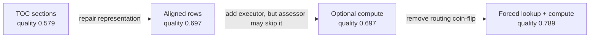

# Computing over Wikipedia tables: overall design to implementation details

This document explains the Checkpoint 5.1 table pipeline from the outside in.
It starts with how a Wikipedia HTML table is broken into reliable data structures,
then follows a table request through planning, deterministic execution, evidence
creation, and reassessment.

The central design decision is:

> The LLM identifies the table operation and produces a constrained plan. Python
> executes the plan over a normalized table. The evidence assessor decides whether
> the computed result is sufficient.

The LLM does not receive raw HTML and perform arithmetic by itself.

---

## 1. Overall view: two different phases

Table handling is divided into a run-once preparation phase and a per-question
agent phase.

```text
RUN ONCE: PREPARE THE TABLE CORPUS

Wikipedia HTML files
        |
        v
parse semantic table structure
        |
        v
normalize spans, headers, cells, annotations, styles, and legends
        |
        v
write compressed per-article artifacts + searchable manifest


PER QUESTION: USE THE PREPARED TABLES

user question
        |
        v
retrieve articles -> review TOCs -> select sections and table artifact IDs
        |
        v
load selected section and table evidence
        |
        v
assess evidence
   |
   +-- selected table has no computed result
   |      -> gateway creates/keeps TableRequest
   |      -> planner classifies lookup/filter/aggregate/...
   |      -> compute_requested_tables
   |      -> reassess evidence
   |
   +-- no table work remains -> retrieval/breadth route or finish
```

This separation avoids parsing large HTML files during every agent run. The graph
only reads immutable normalized artifacts that were prepared ahead of time.

---

# How we broke down Wikipedia tables (This part was heavily influenced by Claude)

A Wikipedia table is not just a rectangular list of strings. Meaning can live in:

- `rowspan` and `colspan` relationships;
- multiple header rows;
- bold or italic formatting;
- superscripts and subscripts;
- footnote targets and note text;
- symbols such as `†`, `‡`, or `*`;
- background colors;
- hidden sortable values;
- captions and surrounding section headings; and
- separate legend or position-key elements elsewhere on the page.

Flattening the HTML with `get_text()` destroys many of those relationships. The
parser therefore represents the table at three levels.

###  One semantic cell: `NormalizedCell`

[`wiki_table_parser.py`](../utils/wiki_table_parser.py) converts each original HTML
cell into a `NormalizedCell`.

The important fields are:

```python
NormalizedCell(
    text="Player A",                 # annotation-free value
    display_text="Player A†",        # value as displayed
    is_header=False,
    is_bold=False,
    is_italic=False,
    bold_text=[],
    italic_text=[],
    annotations=[...],               # superscript/subscript details
    links=[...],
    background_color=None,
    sort_value=None,
    legend_matches=["Pro Bowler"],
    origin_row=4,
    origin_column=2,
    row_span=1,
    column_span=1,
    inherited=False,
)
```

`text` and `display_text` are deliberately separate. For example, `Player A†`
can be used as ordinary data through `text="Player A"`, while the `†` marker and
its meaning remain available through `annotations` and `legend_matches`.

The origin coordinates record where the cell came from in the expanded logical
grid. Copies created by `rowspan` or `colspan` keep the original coordinates and
are marked `inherited=True`.

### One logical table: `NormalizedTable`

The parser groups normalized cells into a `NormalizedTable`:

```python
NormalizedTable(
    artifact_id="immutable-content-derived-id",
    source_article="2020_NFL_draft.html",
    table_id="table-002-...",
    caption="Draft selections",
    section_path=["Player selections"],
    columns=["Pick", "Player", "Position", "Team"],
    rows=[...],
    row_cells=[...],
    header_rows=[...],
    legends=[...],
    warnings=[...],
)
```

It keeps two synchronized views:

- `rows` is the convenient data view: a list of dictionaries containing plain
  strings.
- `row_cells` is the rich semantic view: the corresponding `NormalizedCell`
  objects with formatting, annotations, legends, sort values, and provenance.

The executor uses `rows` for ordinary selection and arithmetic while consulting
`row_cells` for semantic matching and source-cell provenance.

###  One page's catalog entry: `TableCatalogEntry`

The runtime should not load every row from every table merely to decide which
table is relevant. The artifact store therefore publishes a compact catalog entry
for each table:

```python
TableCatalogEntry(
    artifact_id="...",
    source_article="2020_NFL_draft.html",
    table_id="table-002-...",
    table_role="data",
    caption="Draft selections",
    section_path=["Player selections"],
    columns=["Pick", "Player", "Position", "Team"],
    row_count=255,
    legend_meanings=["Pro Bowler", "compensatory selection"],
)
```

This is enough information for TOC review and candidate ranking without placing
the full table in the selection prompt.

---

##  How HTML becomes a normalized table

###  Select data tables

The default selector is:

```text
table.wikitable
```

This intentionally excludes infoboxes, navigation boxes, and most layout tables.
The parser can accept a different selector, but broadening it to every `<table>`
should be an explicit choice.

### Ignore nested-table rows

Wikipedia sometimes uses tables for layout and nests one table inside another.
The parser collects only rows whose nearest parent table is the table currently
being parsed. A nested key table therefore does not become accidental rows in the
outer data table.

### Expand `rowspan` and `colspan`

The HTML grid is converted into a rectangular logical grid.

For a cell such as:

```html
<td rowspan="3">Team A</td>
```

the value is available in all three logical rows. The copied cells retain the
origin cell's coordinates and are marked as inherited. This prevents the common
failure where later columns shift left and no longer align with their headers.

### Build usable column names

The parser first looks for rows in `<thead>`. If none exist, consecutive leading
rows containing only `<th>` cells are treated as headers.

For multi-row headers, the parts are joined into a path-like name:

```text
Regular season / Wins
Regular season / Losses
Postseason / Wins
```

Blank columns receive positional names such as `column_1`. Duplicate names are
made unique, for example `Team` and `Team__2`. Warnings record these repairs.

### Separate base values from annotations

Superscripts and subscripts are removed from the base `text` but preserved as
structured annotations:

```python
CellAnnotation(
    position="superscript",
    text="†",
    role="marker",
    target=None,
    note=None,
)
```

Reference links retain their targets and resolved note text when available. This
supports both ordinary citations such as `[N 1]` and semantic markers such as a
dagger denoting a Pro Bowler.

### Capture visual meaning

The parser retains:

- bold and italic flags;
- the exact bold and italic text;
- cell or row background color;
- Wikipedia `data-sort-value` information;
- links; and
- the complete displayed text.

This matters for Academy Award tables in which a winner may be distinguished by
bold text, a color, or a legend rather than by a separate `Winner` column.

###  Extract and apply legends

The parser recognizes three common legend forms:

- color legends rendered using Wikipedia's legend markup;
- small symbol-key tables such as `† -> Pro Bowler`; and
- abbreviation lists inside a key table, such as `QB -> Quarterback`.

Only legends that actually match a table's symbols, colors, or abbreviations are
attached to that table. A matching cell receives the legend's meaning in
`legend_matches`.

For the NFL example:

```text
Player A†
```

can become:

```python
text = "Player A"
display_text = "Player A†"
annotations = [{"text": "†", ...}]
legend_matches = ["Pro Bowler"]
```

### Attach table context and stable identity

Each normalized table retains:

- its caption;
- its surrounding heading path;
- nearby prose before the table;
- its source article;
- a page-local `table_id`; and
- a content/parser-derived `artifact_id`.

The distinction between the two IDs is useful:

- `table_id` identifies the table within the article and appears in source-cell
  references such as `table-002-...:r17:c3`.
- `artifact_id` is the immutable runtime selection key used to load exactly the
  artifact selected during TOC review.

---

##  The run-once artifact store

[`wiki_table_store.py`](../utils/wiki_table_store.py) builds the normalized corpus.

For each Wikipedia article it writes one compressed JSON artifact containing all
of that article's normalized tables. It publishes `manifest.json` only after the
build succeeds.

The manifest contains:

- schema and parser versions;
- source-directory information;
- file stamps and source hashes;
- the article-to-artifact mapping; and
- the compact table catalog.

At runtime, `TableArtifactStore` is read-only. The agent can list, rank, and load
artifacts, but it cannot silently modify the prepared corpus.

From the `rag_and_context_engineering/` repository root, the store can be prepared
with:

```bash
python -m wikipedia_retrieval_engine.utils.wiki_table_store
```

The builder reuses a valid current store. Use `--force` only when an intentional
full rebuild is needed.

---

# Where table computation enters the graph

Before computation, the graph has already:

1. retrieved candidate articles;
2. reviewed their tables of contents;
3. selected exact section names and table artifact IDs;
4. loaded the selected section evidence; and
5. loaded normalized table rows as ordinary evidence.

The first implementation allowed the evidence assessor to decide whether a table
needed computation where "lookup" was not part of the computation and was supposed to be done by the LLM.
That produced inconsistent behavior: the same question passed
when the assessor requested the tool and failed when it decided it could read the
rows directly.

The final design adds a **table gateway** inside `assess_evidence`:

```text
relevant table artifact selected?
        |
        +-- no  -> honor normal readiness/retrieval logic
        |
        +-- yes -> table_computation evidence already present?
                     |
                     +-- yes -> honor the new assessment
                     |
                     +-- no  -> force not-ready
                              -> preserve assessor requests, or synthesize one
                                 operation="auto" request per selected artifact
```

This makes table processing reliable without removing judgment from the planner.
The gateway decides **that** a selected table must pass through the deterministic
path once. The planner decides **what** that path should do:

- `lookup` for direct extraction or a whole column;
- `filter` for row predicates;
- `aggregate` for count/sum/min/max/average; or
- `compare`, `sort`, or `timeline` when appropriate.

For a synthesized gateway request, the input is deliberately minimal:

```python
TableRequest(
    missing_fact=question,
    source_article="Scores.html",
    table_id="selected-artifact-id",
    operation="auto",
)
```

The assessor may still emit a more explicit request:

```python
TableRequest(
    missing_fact="Teams with at least 1,000 points",
    source_article="Scores.html",
    table_id="selected-artifact-id",
    operation="filter",
    columns_needed=["Team", "Points"],
)
```

Both requests describe an evidence gap. Neither is an executable program until
`plan_table_query()` converts it into a validated `TableQueryPlan`.

---

##  `compute_requested_tables`: overall responsibility

[`compute_requested_tables()`](../wiki_agents/table_nodes.py) is the orchestration
node for one bounded table round.

```text
selected table artifact
              |
              v
      assess_evidence gateway
              |
              v
 EvidenceAssessment.table_requests
              |
              v
    compute_requested_tables
              |
              +--> plan_table_query
              |       LLM produces a constrained TableQueryPlan
              |
              +--> execute_table_query_plan
              |       Python filters/sorts/aggregates normalized rows
              |
              +--> convert TableEvidence to EvidenceItem
              |
              +--> increment table_attempts
              v
         assess_evidence again
```

It is an adapter between three contracts:

- `TableRequest`: what information the assessor or gateway wants extracted;
- `TableQueryPlan`: the validated operation the planner wants executed; and
- `TableEvidence`: the rows, calculation, warnings, and provenance produced by
  deterministic execution.

---

##  Function inputs and owned state

The function receives:

```python
def compute_requested_tables(
    state: AgentState,
    table_store: TableArtifactStore,
    llm: BaseChatModel,
    *,
    max_requests_per_round: int = 6,
) -> AgentState:
```

It reads these state fields:

```python
state["question"]
state["assessment"]
state["assessment"].table_requests
state["evidence"]
state["table_attempts"]
```

It owns only two output fields:

```python
{
    "evidence": updated_evidence,
    "table_attempts": next_round,
}
```

Like the other LangGraph nodes, it returns a partial update. It does not mutate
the shared state object and return the whole object.

---

##  Detailed execution, step by step

### Step 1: validate the node invocation

The node requires:

- `max_requests_per_round >= 1`;
- a non-empty user question;
- an existing `EvidenceAssessment`; and
- at least one `TableRequest`.

The conditional router should guarantee these conditions, but the node validates
them again at its own boundary.

### Step 2: bound the current round

Only the configured number of requests is processed:

```python
requests = assessment.table_requests[:max_requests_per_round]
```

This is one of two table budgets:

- `max_requests_per_round` limits fan-out within one visit to the node.
- `max_table_rounds` limits how many times the graph may revisit the node.

The harness currently uses two rounds and at most six requests per round.

### Step 3: preserve existing evidence

Existing evidence is indexed by `evidence_id`:

```python
evidence_by_id = {
    item.evidence_id: item
    for item in state.get("evidence", [])
}
```

Computed results are additive. Section evidence, graph evidence, raw normalized
table evidence, and earlier computed results remain available for reassessment
and answering.

### Step 4: create an auditable request ID

Each serialized `TableRequest` is hashed. The resulting ID contains the table
round, request position, and a short digest:

```text
table-r1-1-a493bc024e37
```

This provides stable traceability in evidence logs without placing the entire
request in the ID.

### Step 5: call `plan_table_query`

The planner translates the evidence gap into a `TableQueryPlan`.

If `request.operation` is explicit, the planner must preserve it. If it is
`"auto"`, the planner classifies the work from the user question, table schema,
legends, and sample rows. This is what lets the gateway safely handle both simple
lookups and real computation without treating every selected table as an
aggregation problem.

It first resolves the source article and finds candidate artifacts. An exact
`table_id`/`artifact_id` from TOC review is authoritative. If no exact ID exists,
candidate ranking considers:

- caption and section path;
- column names;
- legend meanings;
- normalized row text;
- the missing fact;
- requested columns; and
- requested row-filter values.

The structured planner sees candidate metadata and a small set of query-relevant
sample rows. It must select one supplied artifact and use only its real columns.

Example plan:

```python
TableQueryPlan(
    artifact_id="selected-artifact-id",
    operation="filter",
    selected_columns=["Team", "Points"],
    predicates=[
        TablePredicate(
            column="Points",
            op="num_gte",
            value=1000,
        )
    ],
)
```

The planner chooses the program shape. It does not perform the filtering or
arithmetic itself.

### Step 6: validate the plan

Before execution, validation rejects a plan that:

- selects an artifact that was not supplied;
- changes an explicitly requested operation (`auto` is intentionally free to be
  classified);
- references a nonexistent column;
- selects no output columns;
- requests sorting without a sort column;
- requests aggregation without a supported calculation;
- omits the calculation column for a non-count aggregate;
- supplies a non-numeric threshold to a numeric/year predicate;
- omits the second bound for a range; or
- reverses lower and upper bounds.

Unknown schema fails closed instead of silently returning zero matching rows.

### Step 7: call `execute_table_query_plan`

The executor reloads the chosen artifact and validates the plan again at the
execution boundary.

It then:

1. evaluates text filters and predicates for every normalized row;
2. optionally sorts matching row indexes;
3. applies an optional row limit;
4. returns selected columns or computes an aggregate; and
5. collects the exact contributing cells.

All row selection and calculations happen in Python.

### Step 8: collect source-cell provenance

The executor determines which columns contributed to the result:

- selected columns;
- text-filter columns;
- predicate columns;
- grouping columns;
- sort column; and
- calculation column.

It then records source cells such as:

```text
table-002-ab12cd34:r17:c3
```

The accompanying `TableCellEvidence` retains the cell's semantic details, making
it possible to audit whether a result depended on bold text, a dagger marker, a
legend, or an ordinary value.

### Step 9: convert the result to `EvidenceItem`

The table-specific result is converted to the graph's common evidence contract.
Its content contains three serialized records:

```json
{
  "table_request": {},
  "query_plan": {},
  "result": {}
}
```

This makes the full chain auditable:

```text
what the assessor requested
        -> what the planner proposed
        -> what Python produced
```

The evidence metadata includes:

```python
{
    "retrieval_stage": "table_computation",
    "table_request_id": request_id,
    "operation": plan.operation,
    "calculation": result.calculation,
    "table_computation_sufficient": result.sufficient,
    "warnings": result.warnings,
}
```

This `EvidenceItem` is visible to both the next assessor pass and the final answer
model.

### Step 10: return a partial graph-state update

After every bounded request has been processed, the node returns:

```python
return {
    "evidence": list(evidence_by_id.values()),
    "table_attempts": next_round,
}
```

LangGraph merges those fields into the existing state. The graph then follows:

```python
workflow.add_edge("compute_requested_tables", "assess_evidence")
```

The assessor sees the original evidence plus the computed result and decides
whether the graph is ready, needs retrieval, or needs another table round.

---

##  Predicate details

`TablePredicate` is the deterministic row-selection language.

### Text predicates

```text
contains
equals
```

`contains` may search retained semantic signals, including annotations and legend
meanings. This allows `contains("Pro Bowler")` to match a player cell marked `†`
when the legend explains that symbol.

`equals` compares the normalized plain cell value so appended footnotes or legend
text do not prevent an exact match.

### Numeric predicates

```text
num_gt
num_gte
num_lt
num_lte
num_between
num_any_gt
num_any_gte
```

The ordinary numeric comparisons use the first number in the cell. The `num_any`
variants are for cells containing multiple numeric values.

Numeric parsing recognizes examples such as:

```text
1,200
−12.5
.5
$2,500
($1,200.50)
25%
```

The displayed percentage is treated as its displayed numeric value; `25%` is
parsed as `25`, not `0.25`.

### Year predicates

```text
year_min_gte
year_min_lte
year_any_gte
year_any_lte
year_between
```

Years are extracted separately from ordinary numbers. A value such as
`1998–2004` contains the years `1998` and `2004`.

Use:

- `year_min_gte` when the entire period must begin at or after a cutoff;
- `year_any_gte` when any year in the cell may meet the cutoff; and
- `year_between` when any contained year must fall inside an inclusive range.

---

## Aggregation and sorting details

Supported calculations are:

```text
count
sum
min
max
average
```

For `count`, no calculation column is required. Other calculations require an
exact `calculation_column`.

When `group_by` is present, rows are grouped by the exact string values in those
columns before the calculation is performed.

If any required value cannot be parsed as numeric, the affected aggregate receives
a warning and is not treated as sufficient evidence. The executor does not silently
drop malformed values and calculate over a smaller set.

Sorting uses a retained `sort_value` when Wikipedia provides one. Otherwise it
tries a numeric parse and falls back to normalized text ordering.

---

##  Worked example: numeric row filtering

Question:

```text
Which teams scored at least 1,000 points?
```

### Assessment output

```python
TableRequest(
    missing_fact="Teams with at least 1,000 points",
    source_article="Scores.html",
    table_id="scores-artifact-id",
    operation="filter",
    columns_needed=["Team", "Points"],
)
```

### Planner output

```python
TableQueryPlan(
    artifact_id="scores-artifact-id",
    operation="filter",
    selected_columns=["Team", "Points"],
    predicates=[
        TablePredicate(column="Points", op="num_gte", value=1000)
    ],
)
```

### Normalized rows

```python
[
    {"Team": "Team A", "Points": "1,200"},
    {"Team": "Team B", "Points": "800"},
]
```

### Deterministic executor output

```python
TableEvidence(
    request_id="table-r1-1-...",
    artifact_id="scores-artifact-id",
    result_rows=[
        {"Team": "Team A", "Points": "1,200"},
    ],
    calculation=None,
    source_cells=[
        "table-001-...:r2:c1",
        "table-001-...:r2:c2",
    ],
    sufficient=True,
)
```

### Graph result

The `TableEvidence` becomes an `EvidenceItem` with
`retrieval_stage="table_computation"`. The graph increments `table_attempts` and
returns to `assess_evidence`.

The assessor can now mark the requirement as supported because the numeric filter
has already been executed and its contributing cells are recorded.

---

##  Expected failures and graph behavior

Expected artifact, schema, or plan failures are converted into insufficient
evidence rather than dropping the entire benchmark question.

Examples include:

- unknown article or artifact ID;
- missing artifact file;
- invented column;
- malformed numeric threshold;
- incomplete aggregate plan; and
- no matching rows.

The failure evidence includes the original request and the error message, with:

```python
"table_computation_sufficient": False
```

The next assessor pass can request corrected work, switch to retrieval, or stop
when the configured budgets are exhausted.

Provider failures and rate-limit errors are not intentionally swallowed by the
table node. They propagate to the harness's normal retry/backoff behavior.

---

##  Why table and retrieval budgets are separate

`retrieval_attempts` and `table_attempts` measure different kinds of work:

- retrieval attempts find additional documents or sections;
- table attempts compute over artifacts already found.

The router gives a pending table request priority while table budget remains. If
that budget is exhausted but the assessor also supplied a retrieval request, the
graph may continue to the next configured retriever. If neither action is
available, the graph finishes with its accumulated evidence.

This prevents a repeated malformed table request from consuming the entire
retrieval sequence or creating an infinite loop.

---

## What the final evaluation showed

The table-heavy 19-question GT set separates the contribution of representation,
execution, and routing:

| configuration | quality | strict PASS | article recall | mean context |
| --- | ---: | ---: | ---: | ---: |
| TOC-selected sections | 0.579 | 40.8% | 0.974 | 13.3K |
| aligned normalized tables, read as-is | 0.697 | 57.9% | 0.974 | 28.3K |
| assessor-gated table computation | 0.697 | 61.8% | **1.000** | 43.5K |
| forced lookup + computation gateway | **0.789** | **75.0%** | **1.000** | 44.2K |



The important comparison is the middle pair: adding a correct executor did not
raise mean quality while its use remained assessor-gated. The gain appeared after
the gateway made tool use reliable. This is why routing policy is part of tool
quality; an unused correct tool has no effect on the answer.

### GT10: the representation and plan align

[`sample_agent_state_GT10_annotated.md`](sample_agent_state_GT10_annotated.md)
shows the intended path. The selected `Sport / Years` table has one sport per row
and real headers. Assessment sees that the visible excerpt is incomplete, the
planner emits `year_min_gte(1950)`, Python filters all 16 artifact rows, and the
answer uses the six returned sports plus their source cells. The result passes.

### GT03: orchestration succeeds but the table shape does not

[`sample_agent_state_GT03_annotated.md`](sample_agent_state_GT03_annotated.md)
shows three selected ceremony tables and three successful tool calls. Yet the
parser reports generated positional columns, and each cell contains an entire
award category as one text blob. There is no nominee-per-row relation for Python
to intersect. The answer fails even though retrieval, routing, and execution all
ran.

Together these examples define the boundary of deterministic computation:

```text
good table structure + correct plan + reliable routing -> trustworthy result
bad table structure  + correct routing                 -> deterministic blob
good table structure + skipped tool                    -> model hand-reading
good table structure + wrong plan                      -> precise wrong answer
```

This is the important limit of the table pipeline: deterministic execution makes
the result reproducible, but it cannot repair a malformed relation or an
incorrect plan. The AgentState log is what distinguishes those cases.

The remaining table failures are therefore specific rather than mysterious:

- layout-table normalization for GT03;
- planner correctness for temporal/count aggregation in GT07 and VAL05;
- deciding when deterministic rows clarify a question versus distort an
  uncertainty/conflict question such as VAL06; and
- deterministic joins across independently computed table results.

---

##  Current boundary: what this does not yet do

The current node can execute several independent `TableRequest` objects in one
round. It does not yet perform a deterministic join across the resulting tables.

For a cross-document question, the current behavior is:

```text
request A -> compute result A
request B -> compute result B
final answer model synthesizes A and B
```

A future multi-table operator could instead accept both result sets and perform
an explicit intersection, union, or keyed join in Python with provenance carried
through the operation.

Answering and answer verification also remain outside the LangGraph itself in the
current course harness. The graph writes the terminal evidence state; the harness
then calls the answer model and sends the result to RAGAS.

---

## Code map

- [`wiki_table_parser.py`](../utils/wiki_table_parser.py) — HTML-to-normalized-table
  parsing, span expansion, annotations, legends, and provenance coordinates.
- [`wiki_table_store.py`](../utils/wiki_table_store.py) — run-once artifact builder,
  manifest, catalog, and read-only runtime store.
- [`agentic_models.py`](../wiki_agents/agentic_models.py) — `TableRequest`,
  `TablePredicate`, `TableQueryPlan`, `TableEvidence`, `EvidenceItem`, and
  `AgentState` contracts.
- [`table_nodes.py`](../wiki_agents/table_nodes.py) — candidate resolution,
  planning, validation, deterministic execution, and `compute_requested_tables`.
- [`retrieval_nodes.py`](../wiki_agents/retrieval_nodes.py) — TOC table selection,
  normalized-table evidence loading, and evidence assessment.
- [`agent_graph.py`](../wiki_agents/agent_graph.py) — conditional routing, budgets,
  and the computation-to-reassessment edge.
- [`test_table_nodes.py`](../tests/test_table_nodes.py) — planner, executor,
  provenance, numeric, year, legend, and schema-validation tests.
- [`test_agent_graph.py`](../tests/test_agent_graph.py) — full
  assess-to-compute-to-reassess graph test.
- [`ragas_agent_toc_and_tables_v6.pdf`](ragas_agent_toc_and_tables_v6.pdf) — final
  GT milestone comparison used in §14.
- [`sample_agent_state_GT10_annotated.md`](sample_agent_state_GT10_annotated.md) —
  successful deterministic table path.
- [`sample_agent_state_GT03_annotated.md`](sample_agent_state_GT03_annotated.md) —
  multi-table orchestration and the layout-table limitation.

Run the focused tests from the repository root:

```bash
.venv/bin/python -m unittest discover \
  -s wikipedia_retrieval_engine/tests \
  -p "test_table_nodes.py"

.venv/bin/python -m unittest discover \
  -s wikipedia_retrieval_engine/tests \
  -p "test_agent_graph.py"
```
