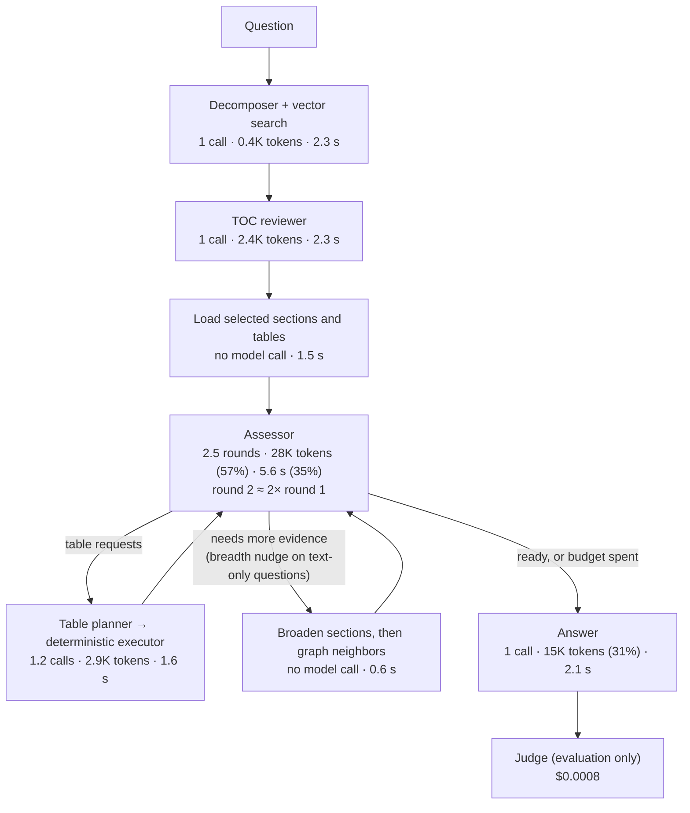

# Introduction and preparation

This README records the performance and cost part of the Checkpoint 6.1 audit
(worksheet Step 3: latency, number of model calls, token usage or cost, and workflow
complexity). The security part is recorded in
[README 6.1 - security assessment](README%206.1%20-%20security%20assessment.md). Steps are
recorded as they happen.

## System under test

The 5.1 survivor, unchanged and with conversation history off, as described in the
security README. Every chat-model role uses `openai/gpt-5.4-mini`:

| Role | Calls per question |
| --- | --- |
| Decomposer (one sub-query per named entity) | 1 |
| TOC reviewer (keeps articles, selects sections and tables) | 1 |
| Assessor | 1 per round; a non-table question takes at least 2 rounds (breadth nudge) |
| Table planner | 1 per flagged table request |
| Answer | 1 |

- The RAGAS judge (`openai/gpt-5.4-mini`, one call per question) is evaluation
  overhead.
- Each vector search embeds its query with `openai/text-embedding-3-small`.
- For comparison, the 4.1 graph retriever makes one chat call per question: the answer,
  over whole articles.

## Measured cost instead of counted tokens

The Module 6 labs count tokens and multiply them by an approximate price table, because
course-issued API keys cannot read account billing. This project has run on a personal
OpenRouter account since the middle of Checkpoint 4.1, with a management key. Billed
cost is therefore available from OpenRouter analytics (per hour, model, and origin), and
prices can be verified.

**Prices** (OpenRouter model lists, retrieved 2026-09-27; USD per 1M tokens), now in
[`pricing/model_prices.json`](pricing/model_prices.json):

| Model | Input | Cached input | Output |
| --- | ---: | ---: | ---: |
| `openai/gpt-5.4-mini` (every role, judge) | 0.75 | 0.075 | 4.50 |
| `openai/gpt-5.4` | 2.50 | 0.25 | 15.00 |
| `openai/gpt-5.5` | 5.00 | 0.50 | 30.00 |
| `openai/text-embedding-3-small` | 0.02 | | |
| models whose id ends in `:free` | 0 | 0 | 0 |

- The gpt-5.4-mini prices reproduce the billed amounts of both analytics windows below
  to the cent.
- The file previously held the Lab 6.2 approximate rates (0.20 input, 0.80 output), which
  understate input by 3.75× and output by 5.6×.
- Embeddings are negligible: 1,307 embedding requests in the 5.1 window were billed
  $0.0002.
- **Per-call cost is reported by OpenRouter.** Every chat response carries the cost
  billed for it (`token_usage.cost`). In the first replay it matched the list-price
  computation to the cent, so per-call cost needs neither analytics nor the price table;
  the table remains for estimates and for separating list from billed cost.

**Attribution: found and fixed.**

- **Found.** The app tags added in Checkpoint 5.1 ("WRE retriever", "WRE judge", "WRE
  embedding") never reached analytics: every request was reported under app "Unknown".
  - OpenRouter identifies an app by its HTTP-Referer, which was identical for every
    role, and a localhost app also needs the `X-OpenRouter-Title` header.
  - The `origin` dimension did report the referer, path included, but one referer meant
    one origin, so judge cost could not be separated from system cost.
- **Fixed** in `retrievers/llm.py` (`openrouter_headers`):
  - each role sends its own referer path: `…/retriever`, `…/judge`, `…/embedding`,
    `…/replay-answer`;
  - `X-OpenRouter-Title` names the role, and `X-OpenRouter-App-Visibility: hidden` keeps
    the localhost apps out of public rankings;
  - the first replay's answer and judge calls appeared as separate origins within
    minutes. Traffic before 2026-09-27 stays under the single origin.
- **`utils/openrouter_usage.py`** expected a `date__day` key, so hourly rows
  (`date__hour`) and `origin` rows (`created_at__day`) printed without dates, and long
  origin names were cut to 24 characters. Both are fixed.
- Hourly buckets are in UTC. Runs are placed in them by their log timestamps (local
  time is UTC−4).

## Existing runs re-read at zero cost

Before any new run, the saved 5.1 and earlier results were re-read. Three findings
shaped the experiments.

### Finding 1: real cost per question, 5.1 survivor against 4.1 graph

Two analytics windows contain the same workload, two GT runs and four validation runs
(138 question-runs each):

- **4.1 graph** (`vs_k7_md_graph_n5retriever`): 2026-09-15, 23:00–23:59 UTC.
- **5.1 survivor** (`agentic_search_compute_broaden` and `agentic_retrieval_5.1_broaden`):
  2026-09-23, 15:00–16:59 UTC.

Neither window contains other traffic. Billed chat requests match the requests implied
by the result CSVs:

- 4.1: 276 billed = one answer and one judge call per question;
- 5.1: 1,049 billed against 1,044 derived from the route traces (decomposer, TOC
  reviewer, one assessor call per round, planner calls, answer, judge), so only five
  retries occurred.

| Per question-run (judge included) | 4.1 graph | 5.1 survivor | 5.1 ÷ 4.1 |
| --- | ---: | ---: | ---: |
| Chat requests | 2.0 | 7.6 | 3.8× |
| Embedding requests | 1.0 | 9.5 | 9.5× |
| Prompt tokens | 74.5K | 46.7K | 0.63× |
| Cached share of prompt tokens | 70.5% | 32.3% | |
| Completion tokens | 281 | 1,447 | 5.1× |
| Billed cost | $0.0217 | $0.0313 | 1.45× |
| Cost at list price, no caching | $0.0571 | $0.0415 | 0.73× |
| End-to-end time per question | about 10 s | 21 s (median) | about 2× |

- **More calls, fewer tokens, higher bill.** The survivor reads 37% fewer prompt tokens
  per question and costs 45% more.
- **Caching reverses the ranking.** At list price the survivor would be 27% cheaper.
  - The 4.1 graph re-sends the same whole articles. In back-to-back repeat runs of the
    same questions, 70.5% of its input was billed at the cached rate, one tenth of the
    input price. A workload of distinct questions would cache less.
  - The survivor's prompts change on every round; 32.3% of its input was cached.
- **Output is a fifth of the survivor's bill** (21%, against 6% for 4.1). The agent
  roles return structured JSON: article reviews, assessments, and table plans.
- **The answer call is about a quarter of the survivor's input.**
  - The answer prompts of the 138 question-runs were counted exactly with tiktoken
    (`o200k_base`), whose count matched OpenRouter's within one token in the replay
    smoke test.
  - They average 12.9K tokens (48.0K characters, 3.7 characters per token): 27.6% of the
    46.7K prompt tokens per question.
  - The judge adds about 610 tokens (1.3%). The agent loop before the answer consumes
    the remaining 71%, so `context_characters`, which measures the answer prompt only,
    understates the survivor's token use about fourfold.
- **The judge is about 2% of the bill.** Two judge calls in the replay smoke test cost
  $0.0015, about $0.0008 per question against $0.0313 billed per question.
- **Latency.**
  - Survivor: 21 s per question end to end (median of the gaps between consecutive
    question logs; p90 36 s, maximum 56 s). Each gap includes the previous question's
    answer and judge calls.
  - 4.1 graph: consecutive runs of 19 or 25 questions finished 3–5 minutes apart, about
    10–12 s per question.

### Finding 2: quality by question type, sections against whole articles

The survivor's TOC review flags whether answering needs a table. Splitting the
validation questions by that flag separates two groups (a question counts as a table
question when at least two of the four runs flagged a table):

| Validation group | 5.1 survivor, sections (4 runs) | Oracle, whole designated articles (4 runs) | 4.1 graph, whole articles (4 runs) | 3.1 vector k=7, whole articles (3 runs) |
| --- | ---: | ---: | ---: | ---: |
| Non-table (11 questions) | 0.955 | 1.000 | 1.000 | 1.000 |
| Table (14 questions) | 0.821 | 0.786 | 0.795 | 0.833 |
| Mean answer context, non-table | 39.6K | 69.6K | 200.5K | 113.6K |

- **Non-table questions:** every whole-article configuration scored 1.000. The survivor
  lost points on two:
  - VAL09 (0.62), the connection between Bill Clinton and Barack Obama;
  - VAL11 (0.88), the Broad Street pump and John Snow.
- **Table questions:** whole articles did not help overall. The survivor's table path is
  ahead on VAL07 and VAL14, and behind on VAL10 (against all three) and VAL05 (against
  two; the planner's temporal aggregation, Cause A in README 5.1).
- **GT:** five questions are non-table (GT02, GT06, GT16, GT17, GT18).
  - The oracle scored 1.000 on all five; the survivor 0.933, losing on GT16 (0.67), the
    same Clinton–Obama family.
  - The 4.1 retrievers scored lower on GT16. The 4.1 base retriever missed the Barack
    Obama article (recall 0.5). The 4.1 graph had both whole articles (recall 1.0)
    inside 284K characters of context and scored 0.50: fail, pass, and partial on an
    identical context.
  - Whole articles helped when they were the designated articles without much else
    around them (the oracle), not whenever the context was large.

### Finding 3: the answer step can be replayed from the logs

The 5.1 AgentState logs store each question's terminal state, including every evidence
item. Rebuilding the answer context from the logs in the 5.1 evidence format
(`format_section_evidence`) reproduced `context_characters` exactly for all 157
question-runs of the seven survivor runs:

| Set | Results CSV → log folder (`Capstone Checkpoint 5.1/logs/`) |
| --- | --- |
| Validation | `distracted_dorsey` → `2026_09_23_11_28_19`; `cranky_stallman` → `2026_09_23_11_44_15`; `eager_rossum` → `2026_09_23_11_55_11`; `objective_hopper` → `2026_09_23_12_05_45` |
| GT | `zealous_liskov` → `2026_09_23_10_29_40`; `happy_hopper` → `2026_09_23_11_03_04`; `stoic_postel` → `2026_09_23_11_13_11` |

A change that affects only what the answer model reads (the context, or the answer model
itself) can therefore be tested on the saved evidence without re-running the agent:

- the agent's selections stay fixed, so a quality difference is attributable to the
  change alone;
- only answer and judge calls are paid.

## Tools for the experiments

| File | Role |
| --- | --- |
| [`usage_accounting.py`](usage_accounting.py) | Shared by both starters: reads one reply's tokens (input, cached, output, reasoning), model, and reported cost; prices a call at list and billed rates |
| [`cost_test_starter.py`](cost_test_starter.py) | Live 5.1 runs with per-call and per-node telemetry. `QuestionUsage.on_llm_end()` is implemented on the shared accounting; `--self-check` passes 9 of 9 checks without API calls |
| [`answer_replay_starter.py`](answer_replay_starter.py) | Re-answers saved 5.1 runs under another context rule or answer model (Experiment 1) |
| [`../wiki_agents/answer_context.py`](../wiki_agents/answer_context.py) | The context rules; works on any finished `AgentState`, live or reloaded from a log |

- **Price lookup.** Replies name a dated model, such as `openai/gpt-5.4-mini-20260317`,
  which also starts with `openai/gpt-5.4`. The first matching prefix would have priced
  gpt-5.4-mini calls at gpt-5.4 rates (3.3× too high) once both were in the table, so
  the longest matching prefix wins. The self-check covers it on the real price file.
- **Tests:** 94 pass, including the new context-rule and per-role header tests.

# Experiment 1: whole articles for non-table questions

**Status:** run 1 complete (2026-09-27, `openai/gpt-5.4-mini`; see Results). The
answer-model comparison has not run yet.

**Hypothesis.** Restricting evidence to sections (5.1) costs quality on text-rich
questions, because the selected sections do not carry all the information the question
needs. Tables are the exception: there, selected sections plus the table path work
better than whole articles.

**Question.** Does quality improve, and what does it cost?

**Support in the existing runs** (Finding 2).

- The rule matches the split in the data: whole articles beat sections only on
  non-table questions, and only on three of them (VAL09, VAL11, GT16).
- The ceiling on validation is small. Moving the non-table group from 0.955 to 1.000
  raises validation quality from 0.880 to about 0.90.

## Design: replay the answer step

**Why a replay.** The variant changes only what the answer model reads, and the saved
5.1 runs already hold the agent's selections (Finding 3). The answer step is therefore
re-run on them:

- the agent is not re-run, so only answer and judge calls are paid;
- the selections are identical in every arm, so a quality difference is attributable
  to the context alone.

A live variant, with whole articles inside the graph, would also change what the
assessor reads on every round. That is a different and more expensive experiment.

**Two rules, both tested** ([`wiki_agents/answer_context.py`](../wiki_agents/answer_context.py)):

| Rule | Kept article that needs no table | Kept article that needs a table |
| --- | --- | --- |
| `sections` (control: 5.1) | its sections | its sections and table evidence |
| `whole_per_question` | the whole article, when no kept article needs a table; otherwise its sections | its sections and table evidence |
| `whole_per_article` | the whole article | its sections and table evidence |

- "Kept" means marked relevant by the TOC review. "Needs a table" is the flag behind the
  5.1 `tables_flagged` column.
- A whole article replaces that article's evidence items at the position of its first
  item. Evidence from other articles (graph neighbors, 2% of the non-table evidence) is
  unchanged.
- The two rules differ only on mixed question-runs, where a narrative article is kept
  next to a table article (listed below). The first formulation was per question: a
  question needs either text or a table. Per article is the finer rule: each article
  gets the representation that fits its role in the answer. The replay makes testing
  both cheap.

**Arms and sharing** ([`answer_replay_starter.py`](answer_replay_starter.py)).

- Each (rule, answer model) pair is an arm.
- A question-run is replayed when the rules give it different contexts: 84 of 157.
- Within a question-run, arms with identical contexts share one answer and one verdict.
  A mixed question-run's per-question answer is therefore the control's answer, and
  their difference is exactly 0.

**Controls built into the replay.**

- **Integrity check.** Before any call, the rebuilt control context must match
  `context_characters` in the 5.1 results for every question-run (157 of 157 pass).
- **Control re-answered.** The control re-answers the unchanged 5.1 contexts on the same
  day with the same judge. It is the pair for every comparison, instead of the 5.1
  verdicts from 2026-09-23, and it measures the noise floor: how much the verdict
  changes on identical input.
- **Cost measured two ways** ([`usage_accounting.py`](usage_accounting.py)):
  - list price, every input token at the full rate;
  - billed, cached input at the cached rate;
  - plus the cost OpenRouter reports for each call.

  List price is the comparison of record. Repeat runs of the same question send
  identical whole-article prompts minutes apart and earn cache hits that a stream of
  distinct user questions would not: the effect that made the 4.1 graph cheap in
  Finding 1.
- **Latency** is measured per answer call; rate-limit waits are excluded.

**Mixed question-runs**, the only ones where the rules differ:

| Question | Runs | Sent whole under `whole_per_article` | Keeps sections and tables |
| --- | ---: | --- | --- |
| GT01 | 2 | Usain_Bolt | 100_metres |
| GT14 | 3 | La_La_Land, Emma_Stone | Damien_Chazelle, 89th_Academy_Awards |
| GT15 | 3 | Harry_Potter_and_the_Philosopher_s_Stone, Harry_Potter_and_the_Chamber_of_Secrets, Daniel_Radcliffe | Chris_Columbus_(filmmaker), Harry_Potter_(film_series) |
| VAL14 | 3 | John_Snow | Queen_Victoria |
| VAL19 | 1 | Albert_Einstein | Michelson–Morley_experiment |
| VAL20 | 1 | Marie_Curie | List_of_Nobel_laureates_in_Physics |
| VAL21 | 4 | Neil_Armstrong | Moon_landing, Apollo_11 (plus List_of_Apollo_missions and Apollo_program in 3 runs) |
| VAL24 | 3 | 1964_Alaska_earthquake (plus 2011_Tōhoku_earthquake_and_tsunami in 2 runs) | Lists_of_earthquakes (plus 2011_Tōhoku_earthquake_and_tsunami in 1 run) |

All eight questions scored 1.00 under 5.1 sections.

## Predictions (recorded before the full replay)

- **Quality.**
  - Whole articles reach about 1.00 on purely non-table questions, as the oracle did.
  - Where a question mixes text and a table, per article comes closer than per question.
  - A stronger answer model closes more of the remaining gap, though not all of it,
    because gpt-5.4-mini may underperform on the larger contexts.
- **Cost.**
  - Table-only questions do not change.
  - Text-only questions rise by at least 30%: broadening already sends several sections
    per article, and whole articles add more text to read.
  - The replay may show more caching than real use would.
  - The variant still costs less than the 4.1 graph, because not every question gets
    whole articles.

**Computed before the run** (zero cost, from the logs). Answer input tokens are counted
exactly; answer output is assumed unchanged. Percentages are relative to the average
survivor question-run (46.7K prompt tokens, $0.0415 at list price), because per-type
baselines need the live telemetry run.

| Question-runs in the billing window | `whole_per_question` | `whole_per_article` |
| --- | --- | --- |
| Text-only (59) | +43% prompt tokens, +37% list cost | same as per question |
| Mixed (18) | unchanged | +44% prompt tokens, +37% list cost |
| Table-only (61) | unchanged | unchanged |
| All (138) | +18.5% prompt tokens, +15.6% list cost | +24.3% prompt tokens, +20.5% list cost |

- **Against 4.1 at list price:** +15.6% puts the survivor at about $0.048 per question,
  still below the 4.1 graph's $0.0571. At billed prices the survivor already costs more
  than 4.1 ($0.0313 against $0.0217, Finding 1).
- **Mixed question-runs** all scored 1.00 under 5.1, so `whole_per_article` can hold
  their quality or lower it, not raise it, and it costs 5 points more than per question
  overall.

**Smoke test** (VAL11, one saved run; $0.0171 for two answer calls):

- control: 37,051 characters, 7,960 input tokens, pass;
- whole articles: 50,278 characters, 12,140 input tokens, pass;
- OpenRouter's reported cost matched the list-price computation to the cent; no cache
  hits; 0 reasoning tokens;
- the original 5.1 verdict on this question-run was partial, so the re-answered control
  already moved by half a point on identical input;
- every fact the grading notes require is in these 5.1 sections, within about 3,000
  characters: the resident interviews ("By talking to local residents…", with Henry
  Whitehead), the dot map, the inconclusive water examination, and the removed pump
  handle. The 09-23 answer left out the resident interviews; today's answer on the same
  sections quoted them. VAL11's loss under 5.1 (0.88, Finding 2) is therefore variation in
  the answer's synthesis, not missing context.

**Planned run:** all 84 changed question-runs, three arms, `openai/gpt-5.4-mini`: 168
answer calls and 168 judge calls, estimated at $3.00 at list price by the dry run.

## Results

### Run 1: three arms on `openai/gpt-5.4-mini` (2026-09-27)

Output: `replay_tests/2026_09_27_12_12_47/` (`summary.md`, `answer_calls.csv`). Every
question-run whose context differs between the rules was replayed: 84 of 157. The run
made 168 answer calls and 168 judge calls in 9 minutes. The answer calls cost $1.59
billed (as reported by OpenRouter) and $2.82 at list price; the dry run had estimated
$3.00 at list price.

**Quality:**

| Question-runs | 5.1 sections, re-answered (control) | `whole_per_question` | `whole_per_article` |
| --- | ---: | ---: | ---: |
| Text-only (64) | 0.914 | 0.961 | 0.961 |
| Mixed (20) | 0.975 | 0.975 (same as control) | 0.950 |
| All replayed (84) | 0.929 | 0.964 | 0.958 |
| Projected validation set (4 runs) | 0.875 | 0.885 | 0.880 |
| Projected GT set (3 runs) | 0.711 | 0.746 | 0.746 |

- Projections combine the replayed verdicts with the 5.1 verdicts of the unchanged
  question-runs. The 5.1 runs as recorded score 0.880 (validation) and 0.754 (GT).
- **Paired against the control:**
  - `whole_per_question`: +0.036 (8 better, 2 worse, 74 unchanged; Wilcoxon p = 0.22);
  - `whole_per_article`: +0.030 (8 better, 3 worse; p = 0.34).
- **Noise floor:** the control's verdict differs from the 09-23 verdict on 6 of 84
  question-runs, on identical input.

**What moved** (`whole_per_question` against the control, 10 changed verdicts):

| Question | Change | Cause, from the answers and contexts |
| --- | --- | --- |
| VAL09 (all 4 runs) | partial → pass | **Missing context.** The section answers state it themselves: "the provided articles do **not** state what position Hillary Clinton held in Obama's administration". The only Secretary of State in these sections is Antony Blinken. The whole Obama article contains "Secretary of State Hillary Clinton". |
| GT16 (run `11_03_04`) | partial → pass | **Missing context,** admitted in the same way ("The provided context does not include a later Obama administration role for her"). |
| GT16 (run `10_29_40`) | partial → pass | **Not missing context.** The sections contain both "a close primary campaign against Hillary Clinton" and "Secretary of State Hillary Clinton". The section answer described the 2008 connection as Bill Clinton campaigning for his wife instead of the Clinton–Obama primary rivalry; the whole-article answer named the rivalry. |
| GT16 (run `11_13_11`) | partial → fail | **A competing answer from more text.** The section answer had admitted that the role was "not contained in the provided text". With 248K characters of whole articles, the answer named Joe Biden, who appears in both articles and fits the 2008 election and a later administration role, instead of Hillary Clinton. |
| GT02 (2 runs) | fail → partial or pass | **Judge disagreement.** Every event, date, and quotation in the control's failing answer is in its context. The judge sees neither the context nor the question, only the response and the grading notes. |
| VAL14 (1 run) | pass → fail | **Omission graded as an error.** The answer gave "Leopold in 1853" without "7 April" (present in both contexts). The grading notes define an omission as partial; the judge returned fail. |

- `whole_per_article` additionally lowered VAL14 in one mixed run (pass → partial).
- The effect is carried by one question family: Clinton–Obama, 6 better and 1 worse.
  The other four changes are answer and judge variation of the size the noise floor
  measures.

**Cost:**

| Question-runs | `whole_per_question` | `whole_per_article` |
| --- | --- | --- |
| Text-only (64) | 3.5× input tokens (8.3K → 29.4K); +38.0% of a 5.1 question at list price, +8.1% billed | same as per question |
| Mixed (20) | unchanged | 2.2× input tokens; +38.3% list, +26.5% billed |
| All 157 question-runs | +15.5% list, +3.3% billed | +20.4% list, +6.7% billed |

- Output tokens did not change (192 per answer for the control, 188 for whole articles).
- The zero-cost predictions of list cost (+15.6% and +20.5%) held to a tenth of a point:
  input tokens were counted exactly beforehand.

**Caching,** as a share of input tokens, by which saved run a call came from:

| Rule | First run of its set | Second | Third | Fourth |
| --- | ---: | ---: | ---: | ---: |
| `sections` | 0% | 12% | 27% | 49% |
| `whole_per_question` | 31% | 88% | 87% | 99% |
| `whole_per_article` (mixed runs only) | 1% | 22% | 49% | 61% |

- Repeats of the same question re-send identical whole-article prompts minutes apart,
  and caching climbs to 88–99%. This is why billed cost rose only 3.3% where list
  price rose 15.5%.
- The first run's 31% has a second source: different questions that lead with the same
  article. VAL12 and VAL13 reused VAL11's Broad Street article (91% and 58% cached),
  GT16 reused VAL09's Clinton and Obama articles (99%), and GT06 reused VAL04's Best
  Actor article (97%). Sections are specific to each retrieval and rarely repeat.

**Latency.** The median answer latency was 1.8–2.1 s at every input size (under 15K
tokens through over 50K; maximum 4.5 s). Output length, which did not change, sets the
answer time. Whole articles cost money, not answer time.

**Predictions against results:**

| Prediction | Result |
| --- | --- |
| Prediction: text-only questions reach about 1.00, as the oracle did | 0.961 (from 0.914). One real miss (GT16, Biden) and two judge-driven ones |
| Prediction: per article comes closer on mixed questions | No: 0.975 → 0.950. No mixed question had headroom |
| Prediction: table-only cost does not change | Held: table-only question-runs keep the 5.1 context |
| Prediction: text-only cost rises at least 30% | Held: +38.0% at list price |
| Prediction: the replay shows more caching than real use | Held: 31% cached in the first run, 88–99% on repeats |
| Prediction: still cheaper than the 4.1 graph | At list price, yes ($0.048 against $0.057 per question). Billed, no: 5.1 already cost more than 4.1 ($0.032 against $0.022) |
| Computed: +15.6% and +20.5% list cost overall | +15.5% and +20.4% |
| Computed: per article can hold or lower mixed questions, not raise them | Lowered (0.975 → 0.950) |

**Reading.**

- **Whole articles fix what sections actually miss.** VAL09 is the clear case: the
  answer model named the gap itself and did not fill it from its own knowledge,
  although the fact is well known. Elsewhere the answer was already in the sections, and
  the extra text changed nothing or, on the largest context, introduced a competing
  answer.
- **The price** is +38% per text-only question at list price, and the overall gain on
  the replayed runs (+0.036) is not statistically distinguishable from the noise floor
  (p = 0.22).
- **Per article** adds cost without benefit on these sets.
- **Evaluation limitation.** The judge grades without the context or the question. It
  therefore judges faithfulness from its own knowledge (GT02) and can grade harder than
  its grading notes (VAL14). Both move verdicts on identical or equivalent answers.

### What-if: whole articles only when the answer admits a gap (zero cost)

**Idea (from the VAL09 answers).** The section answers named their own gap ("the
provided articles do not state…"). Answering from sections first, and a second time
from whole articles only when the first answer admits a gap, would pay for whole
articles only where they are needed. No judge with the right answer is required at run
time: the signal is the answer model's own admission.

**Detector.** A regular expression over the answer, with Markdown emphasis removed: the
supplied material must be the subject of the negation ("the provided articles do not
state", "the supplied context does not include", "cannot answer … from the provided
articles"). A looser first version, adapted from the security starter's rejection
detector, also flagged 6 passing answers in which the article itself expressed
uncertainty ("it is not known precisely…").

**Reliability.**

- **Run 1 answers** (84 control answers): 4 flagged, all partial answers that whole
  articles turned into passes. The Clinton–Obama question-runs show where the misses
  come from:
  - In 6 of the 7, Hillary Clinton's Secretary of State role was absent from the
    sections, and all 6 section answers said so.
  - The regular expression caught 4 of them. The other two were worded differently: "the
    Obama article does not state…" and "not contained in the provided text".
  - In the seventh (GT16, run `10_29_40`) every fact was present. The answer framed the
    2008 connection as Bill Clinton campaigning for his wife, and had nothing to admit.
- **09-23 answers** (157, an independent sample, table questions included): 9 flagged.
  7 are partial answers with real gaps (VAL09 ×3, VAL10 ×3, GT19), and 2 are passing
  answers (GT09), where escalation would cost a call without changing the verdict.
- The pattern was written after reading the run 1 answers, so the run 1 figures are
  optimistic; the 09-23 figures are the fairer estimate.

**Simulated on the run 1 data** (verdicts and costs of the calls already made):

| Policy, 84 replayed question-runs | Quality | Answer calls | Extra list cost per question (all 157) |
| --- | ---: | ---: | ---: |
| Sections only (5.1) | 0.929 | 84 | 0 |
| Whole articles always (`whole_per_article`) | 0.958 | 84 | +20.4% |
| Whole articles after an admitted gap | 0.952 | 88 | +2.9% |

- Escalation keeps about 80% of the quality gain for about a seventh of the cost.
- It avoids both regressions of the always-whole rules (GT16 naming Joe Biden, VAL14),
  because the detector did not flag those section answers.
- A detector that caught all six admissions would reach the same quality at two more
  calls. VAL09's fourth run would pass, and GT16's run `11_13_11` would turn into the Joe
  Biden fail.
- **Errors are asymmetric.** A false alarm costs one extra answer call (about $0.02 at
  list price for a whole-article answer); a miss leaves the 5.1 answer unchanged.
- **Limits.**
  - A regular expression breaks on new phrasings, as two of the six admissions show. A
    structured field in which the answer model lists what it could not answer would not.
  - No self-report catches an answer that is incomplete while the facts are present
    (GT16, run `10_29_40`): the model does not know it chose the weaker relationship.
- **Table path.** The detector also fires on table questions (VAL10, GT19), where the
  gap is in the table evidence. Whole-article escalation there is untested: the replay
  covered only non-table and mixed question-runs.

# Experiment 2: where the cost and the time go, per tool

**Status:** validation run complete (2026-09-27; see Results).

**Question.** Finding 1 established the survivor's cost per question from billing, and
that the answer call is 28% of its prompt tokens. This experiment answers worksheet
Step 3 (latency, number of model calls, token usage and cost, workflow complexity) one
level down:

- Which roles consume the other 71%?
- Where do the 21 s per question go?

**Design.**

- [`cost_test_starter.py`](cost_test_starter.py) runs the unchanged 5.1 survivor live
  on the validation set (25 questions: 11 text-only, 14 table), with history off.
- Telemetry attaches from outside, through LangChain callbacks, so no agent code
  changes. It writes:
  - one row per chat call: role, graph step, input, cached, output, and reasoning
    tokens, latency, list and billed cost, and the cost OpenRouter reports;
  - one row per graph step: wall time, with retrieval steps including their embedding
    calls;
  - one row per question: totals.
- **Roles:** decomposer (`retrieve_initial_articles`), TOC reviewer, assessor (one call
  per round), table planner (one call per table request), and answer.
- **The judge** is not a LangChain model, so the telemetry does not see it. Since the
  per-role referers, its cost is a separate origin in OpenRouter analytics.
- **Why validation rather than GT:** the survivor was selected on it, and it mixes text
  and table questions.

**Smoke test** (VAL04, one live question; output not kept in the repository):

| Role | Calls | Input tokens | Output tokens | Latency |
| --- | ---: | ---: | ---: | ---: |
| Decomposer | 1 | 421 | 72 | 1.4 s |
| TOC reviewer | 1 | 4,227 | 341 | 2.7 s |
| Assessor | 2 | 2,887 and 5,422 (2,176 cached) | 88 and 150 | 1.5 s and 1.5 s |
| Answer | 1 | 4,500 | 102 | 1.4 s |

- **Totals:** 5 calls, 17.5K input tokens, and $0.0150 billed. OpenRouter's reported
  cost matched the billed estimate exactly. Wall time was 8.9 s in the graph plus 1.4 s
  for the answer.
- **The second assessor round re-read the first round's prompt:** 2,176 of its 5,422
  input tokens were cached, the prefix it shares with round 1. VAL04 is a text-only
  question, so the breadth nudge forced the second round, and no planner was called.
- **Graph steps:** decomposition 2.3 s (the model call plus the vector searches), TOC
  review 2.7 s, section loading 0.6 s, broadening 0.3 s.

**Predictions (recorded before the validation run):**

1. **Tokens:** the assessor uses the most input tokens.
2. **Calls:** 7–8 chat calls per question, excluding the judge; VAL04's 5 is low.
3. **Time:** the assessor takes the most time.
4. **Question type:** text-only questions cost more than table questions. Table
   calculation is deterministic, while text-only questions have to pull article text.

## Results: validation run (2026-09-27)

**Output:**

- `cost_tests/wikipedia_GT_validation_set/`: results `experiments/quirky_adleman.csv`,
  telemetry `telemetry/quirky_adleman__*.csv`;
- AgentState logs: `logs/cost_tests/2026_09_27_13_23_33/`.

**The run:**

- 25 questions and 168 chat calls, with no errors and no whole-graph retries. There
  were two schema retries, both assessor calls (VAL02, VAL03).
- Quality 0.860 (20 pass, 3 partial, 2 fail) at article recall 1.000, within the range
  of the four recorded 5.1 runs (0.84–0.90).

**Cost per question:**

- $0.0431 at list price and $0.0356 billed (OpenRouter-reported), plus $0.00075 for the
  judge (25 calls under the `…/judge` origin).
- **Cross-check:** the `…/retriever` origin billed $0.904 for 173 calls: this run's 168
  calls ($0.889 by the telemetry) plus the 5-call smoke test ($0.015).

**Per role:**

| Role | Calls per question | Input tokens per question | Output tokens per question | Cached | Share of input tokens | Share of list cost | Share of billed cost | Share of model time |
| --- | ---: | ---: | ---: | ---: | ---: | ---: | ---: | ---: |
| Decomposer | 1.00 | 428 | 115 | 0% | 0.9% | 1.9% | 2.4% | 10.3% |
| TOC reviewer | 1.00 | 2,400 | 321 | 0% | 4.9% | 7.5% | 9.1% | 17.9% |
| **Assessor** | **2.48** | **28,057** | 681 | 39% | **57.3%** | **56.0%** | **47.3%** | **43.6%** |
| Table planner | 1.24 | 2,891 | 106 | 5% | 5.9% | 6.1% | 7.2% | 12.0% |
| Answer | 1.00 | 15,186 | 189 | 1% | 31.0% | 28.4% | 34.1% | 16.2% |
| All | 6.72 | 48,962 | 1,412 | 23% | | | | |

- **Calls per question:** 5 to 11, median 7. Eight of the 25 questions took the minimum
  of 5.
- **Output:** 1,412 tokens per question and 15% of the list cost. Nearly half of it
  (681 tokens) is the assessor's structured output.
- **Reasoning tokens:** 0.

**Time:** 16.1 s per question, excluding the judge (14.0 s in the graph, 2.1 s for the
answer):

| Step | Seconds per question | Share |
| --- | ---: | ---: |
| `assess_evidence` (2.40 runs per question) | 5.63 | 35.0% |
| `review_and_select_from_toc` | 2.32 | 14.4% |
| `retrieve_initial_articles` (decomposer and vector searches) | 2.26 | 14.0% |
| Answer | 2.08 | 12.9% |
| `compute_requested_tables` (0.64 runs per question) | 1.64 | 10.2% |
| `load_selected_sections` (vector searches, no model call) | 1.48 | 9.2% |
| Broadening, graph expansion, table loading, log | 0.67 | 4.2% |

**By question type** (the run's own `tables_flagged`):

| | Table (15) | Text-only (10) |
| --- | ---: | ---: |
| Calls per question | 7.67 | 5.30 |
| Input tokens per question | 61.5K | 30.1K |
| … read by the assessor | 34.5K | 18.4K |
| … read by the answer | 19.3K | 9.1K |
| … read by the table planner | 4.8K | none |
| Cost per question, list | $0.0529 | $0.0283 |
| Cost per question, billed | $0.0440 | $0.0229 |
| Time per question | 16.9 s | 14.9 s |
| Quality | 0.867 | 0.850 |

**The assessor's prompt grows each round:**

| Round | Questions reaching it | Input tokens | Cached |
| ---: | ---: | ---: | ---: |
| 1 | 25 | 7.2K | 0% |
| 2 | 25 | 14.0K | 45% |
| 3 | 8 | 13.0K | 63% |
| 4 | 3 | 15.0K | 61% |
| 5 | 1 | 20.7K | 92% |

**Design decisions, priced:**

- **The breadth nudge** forces a second assessor round on every text-only question.
  - That round costs $0.0084 at list price ($0.0054 billed) and 2.1 s: 30% of a
    text-only question's list cost.
  - In 5.1 it bought the validation gain from 0.845 to 0.880.
- **The table gateway** routes every flagged table through the planner.
  - The planner itself is cheap: 2.07 calls and $0.0044 per table question, 8% of its
    cost. The executor that runs the plan is deterministic and free.
  - Most of a table question's extra cost is the table data it reads: the assessor
    reads 16K more tokens than on a text-only question, and the answer 10K more.
- **Accumulated evidence is re-read.**
  - Every question reached a second assessor round: text-only questions through the
    nudge, table questions through gateway → computation → reassessment.
  - Round 2's prompt is about twice round 1's (14.0K against 7.2K tokens), with 45%
    served from cache.
  - Across 2.4 assessor rounds and the answer, the evidence is read about three times
    per question.
- **Sequential calls set the latency.**
  - 6.7 model calls run one after another, at a median of 1.1–2.2 s each depending on
    the role. Call latency did not grow with input size in the replay (Experiment 1).
  - Retrieval steps without a model call, mainly the vector searches behind section
    loading, add about 3 s per question.
- **Caching in a single pass** was 23%, against 32% in the 09-23 analytics window of
  six back-to-back runs. The window's $0.0313 billed per question was flattered by
  repeats; a single pass bills $0.0356 plus the judge.

**Predictions against results:**

| Prediction | Result |
| --- | --- |
| 1. The assessor uses the most input tokens | Held: 57% of input tokens, 56% of list cost |
| 2. 7–8 calls per question | Held for the median (7). Mean 6.72, range 5–11 |
| 3. The assessor takes the most time | Held: 35% of the wall time, 5.6 s per question |
| 4. Text-only questions cost more than table questions | Did not hold: table questions cost 1.9× as much ($0.0529 against $0.0283 at list price). The deterministic executor is free and the planner is cheap (8%), but the rows it extracts are read again by the assessor and by the answer |

# Conclusion: performance and cost, organized by worksheet question

**Testing completed.** The performance and cost evidence comes from three sources:

- **Billing** (Finding 1): OpenRouter analytics for two matched workloads of 138
  question-runs each, the 4.1 graph and the 5.1 survivor.
- **Experiment 1** (answer replay): 84 saved question-runs re-answered under three context
  rules.
- **Experiment 2** (live telemetry): the survivor on the 25 validation questions, with
  every model call and graph step recorded.

The security findings (worksheet Steps 1 and 2) are in
[README 6.1 - security assessment](README%206.1%20-%20security%20assessment.md). This
section covers Step 3, the performance side of Steps 1, 4, and 5, and a combined
selection for the worksheet.

## Step 3: performance and cost analysis

**Performance observations.**

- **Per question:**
  - 6.7 model calls (median 7, range 5–11) plus one judge call, and 49K input tokens;
  - $0.036 billed ($0.043 at list price), plus $0.0008 for the judge;
  - 14.1 s median for the agent and the answer (p90 23 s, maximum 30 s).
- **End to end, including the judge:** 15 s median in the validation run against 21 s
  on 2026-09-23 (Finding 1). The provider's latency varies by day; the shares by step
  are what the telemetry establishes.
- **Against the one-call 4.1 graph** (same workload): 3.8× the model calls, about twice
  the latency, 37% fewer prompt tokens, and 45% more billed cost.
  - The 4.1 graph's repeated whole articles were billed mostly at the cached rate.
  - At list price, the survivor is 27% cheaper.
- **The assessor is the cost centre:** 2.5 calls per question, 57% of the input tokens,
  and 35% of the time.
- **Table questions cost 1.9× as much as text-only questions** ($0.053 against $0.028 at
  list price), although the table planner itself is only 8% of a table question's cost.
- **The same question can cost several times as much in another run.** VAL04 cost $0.088
  in the validation run and $0.015 in the smoke test an hour earlier, with the same
  verdict.
- **Latency follows the number of sequential calls, not their size.** Each call takes
  1–2 s, and answer latency stayed at 1.8–2.1 s from under 15K to over 50K input tokens.
- **Workflow complexity:**
  - 5 model roles and 8–14 graph steps per question;
  - every question took at least two assessor rounds: 18 of 25 exactly two, 7 three to
    five;
  - 4 of the 25 questions were answered once the escalation or table budget ran out,
    without the assessor declaring the evidence ready.

**Evidence.**

| Measurement | Value | Source |
| --- | --- | --- |
| Cost per question | $0.0356 billed, $0.0431 list, judge $0.00075 | Experiment 2 telemetry, cross-checked against the OpenRouter `…/retriever` and `…/judge` origins |
| Calls per question | 6.72 (5–11) | Experiment 2 `llm_calls.csv` |
| Input tokens by role | assessor 57%, answer 31%, table planner 6%, TOC reviewer 5%, decomposer 1% | Experiment 2 |
| Time by graph step | assessor 35%, TOC review 14%, initial retrieval 14%, answer 13%, table computation 10%, section loading 9% | Experiment 2 `node_timings.csv` |
| Assessor prompt by round | 7.2K tokens in round 1, 14.0K in round 2 (45% cached) | Experiment 2 |
| Table against text-only question | 61.5K against 30.1K input tokens; $0.053 against $0.028 at list price | Experiment 2 |
| The same question across runs | 6 questions flagged as table questions in only some runs: their context was a median 2.0× larger when flagged (up to 3.7×), with the same verdicts. VAL04: 6× the cost | Saved 5.1 logs; Experiment 2 |
| 5.1 against 4.1, per question | 7.6 against 2.0 requests; 46.7K against 74.5K prompt tokens; $0.0313 against $0.0217 billed | OpenRouter analytics (Finding 1) |
| Context size against quality | Whole articles: text-only questions 0.914 → 0.961, for +38% of a text-only question's cost | Experiment 1 |
| Latency against input size | 1.8–2.1 s median answer latency at every input size | Experiment 1 |

**Identified bottlenecks or inefficiencies.**

1. **Re-reading accumulated evidence.**
   - Each assessor round re-sends everything gathered so far: round 2's prompt is twice
     round 1's.
   - The evidence is read about three times per question: 2.4 assessor rounds plus the
     answer.
   - `context_characters`, which measures only the answer prompt, therefore understates
     the survivor's token use about fourfold.
2. **Forced second rounds.** The breadth nudge sends every text-only question through a
   second assessor round, 30% of its cost. Table questions return to the assessor after
   their computation.
3. **Table data travels downstream.** The executor's rows are read again by the assessor
   (+16K tokens against a text-only question) and by the answer (+10K).
4. **Unnecessary table selection.** When the TOC reviewer selects tables a question does
   not need, the context grows 2× (median) and the cost up to 6×, with no change in
   quality.
5. **Sequential execution.** 6.7 model calls run one after another at 1–2 s each.
   Vector searches outside the model calls add about 3 s per question.
6. **The evaluation judge.**
   - It costs about 2% of a question.
   - It sees neither the question nor the context, so it cannot check faithfulness
     (GT02), and it can grade harder than its grading notes (VAL14).

**Contributing design decisions.**

| Decision (checkpoint) | Effect |
| --- | --- |
| An LLM assessor decides when the evidence suffices (5.1) | 2.5 calls per question and 57% of input tokens. The loop makes latency about twice the 4.1 graph's |
| Evidence accumulates, and every round re-reads all of it (5.1) | Round 2 ≈ 2× round 1; about three reads of the evidence per question |
| Breadth nudge: a text-only question's first "ready" is denied (5.1) | One extra round per text-only question, 30% of its cost; it bought validation quality 0.845 → 0.880 |
| Table gateway: every selected table goes through the planner (5.1) | Planner calls are cheap (8%), but the extracted rows are re-read, so table questions cost 1.9×. The cap of 6 requests per round bounds the worst case |
| Any table the TOC reviewer selects makes the question a table question (5.1) | Routing varies between runs, and cost varies with it (2× median, VAL04 6×) |
| Sections instead of whole articles (5.1) | The answer context is 5× smaller than 4.1's. Facts outside the selected sections are missed (VAL09); whole articles recover them for +38% |
| One model, `gpt-5.4-mini`, in every role, without reasoning (4.1–5.1) | Low price per token; no role gets a stronger or a cheaper model |
| Nodes and questions run one at a time (5.1) | Latency is the sum of the calls |

**Diagram:** the survivor's workflow with the Experiment 2 averages per question.



## Step 1 addition: cost amplification

A performance issue that belongs beside the security issues A–D in the security
README:

| # | Issue | Example input | Example output | Risk classification |
| --- | --- | --- | --- | --- |
| E | Some inputs multiply the cost of a question: routing that selects many tables, or a question that exhausts every escalation | VAL04, a question about the Best Actor nomination procedure (validation run); the security runs' questions about a non-existent actor | VAL04: 12 winner tables selected, 6 planner calls, 143K characters of context, and $0.088 against $0.015 in the previous run, with the same answer. The non-existent actor: every escalation used, about 130K characters of context | System-level vulnerability (unbounded consumption) |

- **Bounded, but not by the input.** The budgets (2 table rounds, 6 requests per round,
  2 escalation stages) cap the cost, so the amplification has a ceiling. Nothing in the
  pipeline keeps an input from reaching those caps.
- **Root cause (Step 2):** prompt or workflow design.
  - Any selected table makes a question a table question, and every selected table is
    loaded and planned.
  - A question about a missing entity looks the same as one that needs more evidence.

## Step 4: trade-offs (performance)

**Trade-off 1: agentic depth against cost and latency.**

- **The trade-off.** The 5.1 loop (assessor rounds, table gateway, breadth nudge)
  matched the 4.1 graph's quality (validation 0.880 against 0.885, GT 0.754 against
  0.754) with perfect article recall and a fifth of the answer context. It costs 3.8×
  the model calls, about twice the latency, and 45% more billed cost than the one-call
  4.1 graph.
- **Why it occurs.** Every decision point is a model call, the calls run in sequence,
  and each assessor round re-reads the accumulated evidence.
- **Impact.** 14–16 s per question; the assessor alone is 57% of the tokens; the breadth
  nudge alone costs 30% of a text-only question for +0.035 validation quality.

**Trade-off 2: context size against cost and reliability.**

- **The trade-off.** Sections keep the answer context small. Whole articles recover
  facts outside the selected sections (text-only questions 0.914 → 0.961) for +38% of a
  text-only question, and occasionally introduce a competing wrong answer (GT16: Joe
  Biden, in 248K characters).
- **Why it occurs.** The answer model can use only what is in its context, and more
  context means more tokens and more candidate answers.
- **Impact.**
  - Whole articles always: +15.5% per question overall at list price, for +0.036 on the
    replayed question-runs (not significant, p = 0.22).
  - Whole articles only after an admitted gap: about 80% of that gain for +2.9%
    (simulated).

**Trade-off 3: flexible routing against predictable cost.**

- **The trade-off.** The TOC reviewer chooses sections and tables freely, so one agent
  serves text, table, and mixed questions. The same freedom makes a question's cost vary
  between runs.
- **Why it occurs.** Routing is a model decision at temperature 0.2, and a single
  selected table is enough to load tables and call the planner.
- **Impact.** The context is a median 2× larger when tables are selected unnecessarily,
  and VAL04 cost 6× as much, with no change in quality. Average cost figures do not
  bound the cost of a single question.

## Step 5: reflection (performance)

**Most significant performance risk: per-question cost that cannot be predicted.**

- Averages are stable: list-price cost per question agrees within 6% between the
  2026-09-23 billing window and the validation run.
- A single question varies up to 6× with routing, and an input can drive it to the
  budget caps (issue E).

**Key lessons.**

1. **The number of sequential model calls sets latency; the size of the context sets
   cost.**
2. **An agent reads its evidence more than once.** Measuring only the answer prompt
   understates the tokens about fourfold.
3. **Deterministic computation is free, but its output is not.** The rows it extracts
   are read by every later model call.
4. **Caching can reverse a cost comparison.** Repeated evaluation runs of static prompts
   are billed mostly at the cached rate, so comparisons belong at list price.
5. **The answer model reports missing context reliably** (all 6 Clinton–Obama gaps),
   which makes escalation on an admitted gap cheap. It cannot report an answer to the
   wrong question (GT16, run `10_29_40`).
6. **The evaluation judge is itself a source of variation:** 6 of 84 verdicts changed
   on identical input.

**Future investigation priorities (performance).**

1. **Incremental assessment:** later rounds receive the new evidence and the previous
   assessment instead of everything again.
2. **Escalation on an admitted gap in place of the breadth nudge,** with a structured
   field in which the answer model lists what it could not answer.
3. **A table-selection guard:** load and plan tables only when the TOC review sets
   `needs_table_reader`, and cap the tables per article.
4. **A judge with context:** give it the question and the evidence, and take the
   majority of several judgments (the consistency test from Lab 5.1).
5. **Per-role models** (Lab 6.2): a cheaper assessor and a stronger table planner. The
   replay and the telemetry measure both. Experiment 3 has since shown that a stronger
   planner alone does not help. A stronger TOC reviewer is the cheapest candidate (7% of
   the `gpt-5.4` bill): its `needs_table_reader` decision fixed VAL24. The other table
   fixes come after routing (section choice, the assessor, or the answer).
6. **A row cap on table computations** (Experiment 3): nothing limits the rows a
   computation adds to the evidence, and `gpt-5.4-nano` overflowed the 400K-token
   context on VAL24.
7. **Readiness after a table round that checks the prose requirements** (Experiment 3,
   VAL24): a single successful computation ended the loop before the prose facts
   arrived.

## Combined selection for the worksheet

| Worksheet part | Selection |
| --- | --- |
| Step 1 | Issues A–D (security README) and E (above) |
| Step 2 | The security README's root-cause table; for E, the design decisions above (table gateway, TOC table selection, escalation budgets) |
| Step 3 | This section: observations, evidence, bottlenecks, design decisions, and the diagram |
| Step 4 | Trade-offs 1 and 2 above, and "compensation against safety" from the security README (reliability against security). Alternates: trade-off 3 above (flexibility); "conversation memory against exposure" from the security README; model capability against cost (Experiment 3: `gpt-5.4` reached 0.960 at 3.6× the list cost of `gpt-5.4-mini`); surfaced gaps against answer completeness (Experiment 3: VAL06) |
| Step 5 | Most significant risk: silent adoption with false provenance (security README), with per-question cost as the performance counterpart. Lessons: security lessons 1, 2, and 4 with performance lessons 1, 3, and 5. Priorities: the synthesis fix (security priority 1), incremental assessment, escalation on an admitted gap, the answer-grounding check, and a judge with context |

## Supporting materials (performance)

| Material | Location |
| --- | --- |
| Test cases | `answer_replay_starter.py` (context rules; `--dry-run` rebuilds every context); `cost_test_starter.py` (validation set); question sets in `GT/` |
| System outputs | `replay_tests/2026_09_27_12_12_47/` (`answer_calls.csv`, `summary.md`); `cost_tests/wikipedia_GT_validation_set/experiments/quirky_adleman.csv` |
| Performance measurements | `cost_tests/wikipedia_GT_validation_set/telemetry/quirky_adleman__llm_calls.csv`, `__node_timings.csv`, `__question_telemetry.csv`; OpenRouter analytics by origin and hour (`utils/openrouter_usage.py --analytics`) |
| Screenshots or diagrams | The workflow diagram in Step 3; `retriever_phylogeny.html` (repository root) for the lineage from 1.1 to 5.1 |
| Other supporting evidence | `logs/cost_tests/2026_09_27_13_23_33/` (one AgentState per question); `pricing/model_prices.json` (verified prices) |

# Experiment 3: the 6.1 survivor

**Status:** validation runs complete (2026-09-27; see Results).

**Design** ([`survivor_6_1.py`](survivor_6_1.py); decided 2026-09-27):

- **Whole articles replace the breadth step** (rule `whole_per_question`, Experiment 1):
  - no breadth nudge;
  - the first escalation loads the whole kept articles of a question without tables
    (`whole_article`), then graph neighbors;
  - the answer reads the whole articles; table questions keep the 5.1 path.
- **Incomplete evidence is surfaced, not passed along.** This is the synthesis fix of
  record, parts 2 and 3:
  - the planner's predicate slip (the operation written as a key, 26 of 35 rejected
    plans in the 5.1 runs) is repaired, and a plan that still fails gets one corrected
    retry;
  - empty or failed computations are labeled INCOMPLETE;
  - an incomplete final state adds an evidence-status notice to the answer.
- **Models are arguments:** `--model` (every role) and `--table-model` (the planner
  only). The judge stays `gpt-5.4-mini`.
- Every option defaults to the 5.1 behavior, so 5.1 runs as before.

**Verification (zero cost unless noted):**

- 105 unit tests pass (11 new).
- Replaying the notice signals over the saved 5.1 logs reproduces the security what-if
  exactly: not ready 10 (validation) and 6 (GT); incomplete computation 20 and 21. The
  notice would fire on 24 of 100 validation question-runs, 14 of which passed.
- Smoke test (mini, $0.17):
  - VAL09: the assessor found the gap, whole articles fixed it, pass, at $0.099 (5.1:
    $0.027), because the assessor re-reads the whole articles.
  - VAL05: all 4 computations ran (one after the corrected retry); two came back empty
    and were labeled incomplete; the answer said so, but the non-empty 2000s
    computation was wrong (Cause A), fail.
- **Model smoke tests on VAL05** (one question each; n = 1, so no quality conclusion):
  - `gpt-5.4-nano`: partial, with 5 assessor and 8 planner calls;
  - `gpt-5.4`: pass;
  - `gpt-5.4` as table planner only: fail;
  - the free `nvidia/nemotron-3-super-120b-a12b:free`: pass, after about 26 minutes
    for the one question. Its outputs were long (the planner wrote 10.8K output
    tokens), and free models are rate-limited. A full validation run would take about
    11 hours, so it runs on the first 5 validation questions only.

**Predictions (recorded before the validation runs).** The runs were delegated, so
these are computed from Experiment 1, Experiment 2, and the smoke tests:

- **Quality:**
  - text-only questions near 0.95 (Experiment 1: 0.914 → 0.961 with whole articles);
  - table questions level with 5.1 or slightly better: the repair recovers rejected
    plans, but wrong computations that return rows remain;
  - validation overall 0.87–0.91, within noise of 5.1 (0.880 recorded, 0.860 in
    Experiment 2).
- **Cost:** a text-only question ready after round 1 costs less than in 5.1 (no forced
  round), and one that escalates costs 3–4× (VAL09: $0.099 against $0.027). Overall +10%
  to +25% at list price, about $0.047–0.054 per question against $0.0431.
- **Latency:** level with 5.1 on average (about 16 s): one round fewer on text questions
  that are ready, one heavier round on those that escalate.
- **Models:**
  - `gpt-5.4-nano`: about a quarter of the cost, lower quality, and more calls;
  - `gpt-5.4`: about 3× the cost, higher quality on table questions;
  - planner only on `gpt-5.4`: about +10% cost;
  - the free model: zero cost, about 26 minutes per question.
- Analyzer: cost section added (telemetry is merged per run, several
  `--experiments-dir` folders are accepted). The console output of the 5.1 and 4.1
  validation reports is identical to before the change.

**Commands** (from `rag_and_context_engineering/`):

```bash
# 6.1 survivor, three validation runs (repeat three times)
python "wikipedia_retrieval_engine/Capstone Checkpoint 6.1/cost_test_starter.py" --survivor 6.1 --gt-set "wikipedia_retrieval_engine/GT/wikipedia_GT_validation_set.csv"
# model comparison, one run each
python "wikipedia_retrieval_engine/Capstone Checkpoint 6.1/cost_test_starter.py" --survivor 6.1 --model openai/gpt-5.4-nano
python "wikipedia_retrieval_engine/Capstone Checkpoint 6.1/cost_test_starter.py" --survivor 6.1 --model openai/gpt-5.4
python "wikipedia_retrieval_engine/Capstone Checkpoint 6.1/cost_test_starter.py" --survivor 6.1 --table-model openai/gpt-5.4
# free model: first 5 validation questions only (about 26 minutes per question in the smoke test)
python "wikipedia_retrieval_engine/Capstone Checkpoint 6.1/cost_test_starter.py" --survivor 6.1 --model nvidia/nemotron-3-super-120b-a12b:free --limit 5 --experiment-name "survivor_6_1__nemotron-3-super-120b-a12b__first5" --output-dir "wikipedia_retrieval_engine/Capstone Checkpoint 6.1/cost_tests/free_model_first5"
# report: 5.1 history against the 6.1 runs, with the cost section
python wikipedia_retrieval_engine/utils/analyze_ragas_experiments.py --experiments-dir "wikipedia_retrieval_engine/Capstone Checkpoint 5.1/ragas_validation_GT_5.1" "wikipedia_retrieval_engine/Capstone Checkpoint 6.1/cost_tests/wikipedia_GT_validation_set" "wikipedia_retrieval_engine/Capstone Checkpoint 6.1/cost_tests/free_model_first5" --output "wikipedia_retrieval_engine/Capstone Checkpoint 6.1/ragas_6_1_survivor_vs_5_1.pdf" --title "6.1 survivor against 5.1 (validation set)"
```

## Results (2026-09-27)

**The runs.** All ran on the validation set, one question at a time, with the same judge:

| Configuration | Result CSVs (`cost_tests/…/experiments/`) | Question-runs | Pass / partial / fail | Quality |
| --- | --- | ---: | --- | ---: |
| 6.1, `gpt-5.4-mini`, 3 runs | `dazzling_minsky`, `nifty_mccarthy`, `angry_babbage` | 75 | 60 / 9 / 6 | 0.860 (0.880, 0.800, 0.900) |
| 6.1, `gpt-5.4` | `nifty_andreessen` | 25 | 24 / 0 / 1 | **0.960** |
| 6.1, `gpt-5.4` as table planner only | `keen_zuckerberg` | 25 | 21 / 1 / 3 | 0.860 |
| 6.1, `gpt-5.4-nano` | `tender_hopper` | 24 of 25 | 18 / 1 / 5 | 0.771 |
| 6.1, free `nemotron-3-super-120b-a12b` | `free_model_first5/…/ecstatic_bezos` | 4 of 5 | 3 / 0 / 1 | 0.750 |

- The baseline is 5.1: 0.880 over the four recorded runs, and 0.860 in Experiment 2
  (same day, same telemetry).
- Article recall was 1.000 in every configuration.
- Two question-runs were lost:
  - **nano on VAL24:** the context window overflowed. Seven table computations
    returned large row sets, the assessor's next prompt reached about 510K tokens
    against a 400K limit, and every later call failed.
  - **the free model on VAL05:** the provider returned "Service temporarily overloaded"
    (503), which the rate-limit backoff does not retry.
- Report: `ragas_6_1_survivor_vs_5_1.pdf` (quality, recall, per-question heatmap, and
  the new cost section).

**Cost and latency per question** (telemetry; judge excluded):

| Configuration | Calls | Input tokens | List $ | Billed $ | Seconds (mean / median) |
| --- | ---: | ---: | ---: | ---: | --- |
| 5.1 (Experiment 2) | 6.72 | 49.0K | 0.0431 | 0.0356 | 16.1 / 14.1 |
| 6.1, `gpt-5.4-mini` | 5.79 | 49.1K | 0.0422 | **0.0296** | **12.8 / 11.0** |
| 6.1, `gpt-5.4` | 6.20 | 52.6K | 0.1524 | 0.1292 | 21.6 / 18.0 |
| 6.1, planner `gpt-5.4` | 5.72 | 51.9K | 0.0487 | 0.0399 | 14.4 / 11.4 |
| 6.1, `gpt-5.4-nano` | 7.96 | 110.8K | 0.0252 | 0.0163 | 25.9 / 24.8 |
| 6.1, free (4 questions) | 6.00 | 60.0K | 0 | 0 | 520 / 66 |

**By question type** (6.1 `gpt-5.4-mini` against 5.1 in Experiment 2):

| | Text-only | Table |
| --- | --- | --- |
| Question-runs | 39 against 10 | 36 against 15 |
| Quality | **0.974** against 0.850 | **0.736** against 0.867 |
| List cost | $0.0367 against $0.0283 (+30%) | $0.0482 against $0.0529 (−9%) |
| Billed cost | $0.0234 against $0.0229 (+2%) | $0.0363 against $0.0440 |
| Time | 10.5 s against 14.9 s | 15.3 s against 16.9 s |

**Whole articles (text-only questions).**

- 34 of 39 text-only question-runs were ready after the first assessment. They cost
  $0.0277 at list price, the same as a 5.1 text question, because the removed nudge
  round pays for the larger whole-article answer. They took 9.5 s and scored 1.000.
- The 5 that escalated (VAL15 ×2, VAL17, VAL02, VAL09) cost $0.0979, took 17.5 s, and
  scored 0.800: the assessor re-read the whole articles.
- VAL09 went from 0.60 to 1.00 and VAL11 from 0.90 to 1.00. Every text-only question
  scored 1.00 in all three runs.

**Surfaced gaps and the planner repair (table questions).**

- Rejected table plans fell to 7% (5 of 71 computations), from 10% in Experiment 2 and
  17% in the 2026-09-23 runs. Empty results were unchanged (14% against 13%); they come
  from wrong filters, which the repair does not address.
- The evidence notice fired on 9 of 75 question-runs (5 partial, 2 fail, 2 pass).
- The table group fell from 0.867 to 0.736, mostly on two questions. Their logs show
  two different mechanisms:
  - **VAL24** (Alaska against Tōhoku: dates, magnitudes, durations) fell from 1.00 to
    0.33. In all four 2026-09-23 runs, failed or empty computations kept the assessor
    asking for more, and the broadened sections brought the prose facts: pass. In two
    6.1 runs a single computation succeeded, the assessor declared the evidence ready
    at once, no broadening followed, and the answer lacked the facts: fail. In 5.1,
    failed computations were rescuing this question by accident.
  - **VAL06** (a filter over the deadliest-earthquakes table) fell from 0.80 to 0.33.
    The computation returned no rows in 5.1 and in 6.1 alike. Under the 6.1 label and
    notice, the answer never claimed that no event qualifies (the fail mode of
    Experiment 2's 5.1 run), but it hedged ("I can only answer from the visible article
    data") and was graded partial, fail, and partial.

**Models.**

- **`gpt-5.4` in every role reached 0.960,** the highest validation quality in the
  project (text-only 1.000, table 0.909). It fixed VAL05 (Cause A), VAL06, and VAL24,
  at 3.6× the list cost of `gpt-5.4-mini` (4.4× billed) and 1.7× the time. It is a
  single run: against the mean of the three mini runs it was better on 6 questions and
  worse on 1 (VAL02), which is not significant at this size (Wilcoxon p = 0.08).
- **Its fixes came from two places.** On VAL24 the `gpt-5.4` TOC reviewer did not set
  `needs_table_reader`: the question compares looked-up values (dates, magnitudes,
  durations), and the reviewer prompt reserves the flag for computations over table
  rows. The question took the text path, the assessor asked for more, and the
  whole-article escalation delivered the prose facts. The mini reviewer set the flag in
  all three runs, and in two of them the single successful computation ended the loop.
  The two reviewers also disagreed on VAL14, VAL19, and VAL20 (flagged in two of three
  mini runs, never by `gpt-5.4`), with little effect on their scores. On VAL05, VAL06,
  VAL08, and VAL10 both models took the same table path, so those gains come after
  routing: section choice, the assessor, or the answer.
- **`gpt-5.4` as table planner only** changed nothing overall (0.860, +15% list cost);
  only VAL24 improved, through three escalation rounds rather than through routing. The
  planner alone is not what fixed the table questions.
- **By role, the answer (43%) and the assessor (41%) carry most of the `gpt-5.4` bill.**
  The TOC reviewer that made the VAL24 routing decision is 7% ($0.009 per question,
  against $0.002–0.003 with mini).
- **`gpt-5.4-nano`** answered every text-only question correctly, fell to 0.577 on table
  questions, and crashed VAL24. It was 40% cheaper at list price but twice as slow,
  with 2.3× the input tokens and more calls.
- **The free model** also answered its text-only questions correctly. It averaged 520 s
  per question: VAL02 took 32 minutes and produced a 473,208-character answer. It lost
  one question to a provider error. At zero cost it is not usable for the agent.

**Predictions against results:**

| Prediction | Result |
| --- | --- |
| Text-only questions near 0.95 | Held: 0.974 |
| Table questions level or slightly better | Did not hold: 0.736 against 0.867 (VAL24 control flow, VAL06 hedging) |
| Validation overall 0.87–0.91 | Slightly below: 0.860, level with Experiment 2 |
| Cost +10% to +25% at list price | Did not hold: −2% overall (text-only +30%, table −9%); billed −17% |
| Latency level | Did not hold: −20% (12.8 s against 16.1 s) |
| `gpt-5.4-nano` about a quarter of the cost, lower quality, more calls | Partly: 0.6× the list cost (it used 2.3× the input tokens); quality 0.771; 7.96 calls |
| `gpt-5.4` about 3× the cost, better on tables | Held: 3.6×, table 0.909 |
| Planner only about +10% | Held: +15%, no quality change |
| Free model: zero cost, about 26 minutes per question | Mostly held: $0; 520 s mean, 32 minutes on VAL02 |

**Reading.**

- **The 6.1 architecture trades table quality for text quality, speed, and billed
  cost.** At the same overall quality as 5.1 (0.860), it answers text-only questions
  almost perfectly, is 20% faster and 17% cheaper billed, and tells the user when a
  computation did not complete. Two table questions regressed.
- **Fixing one failure changed the control flow.** Failed computations kept the loop
  going in 5.1, so they also delivered prose that some table questions needed (VAL24).
  Readiness after a table round has to consider the question's prose requirements, not
  only the computation.
- **Surfacing a gap has a quality cost on partially supported answers** (VAL06): the
  notify-against-quality trade-off, even without refusals.
- **The remaining table failures are largely model capability,** in two places: the TOC
  reviewer's routing (`gpt-5.4` did not flag VAL24 as a computation) and the later
  roles that read table evidence (VAL05, VAL06). A stronger planner alone did not help.
  The `gpt-5.4` lead comes from one run (p = 0.08 against the three mini runs).
- **Two new risks, both unbounded consumption (issue E):**
  - table computations have no cap on the rows they add, so a weak planner can
    overflow the context window (nano, VAL24);
  - a free provider can be very slow, overloaded, or produce runaway output.
